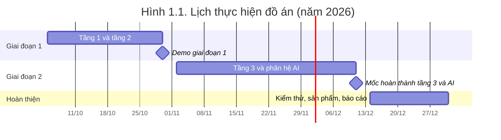

# Chương 1. Giới thiệu

> Trạng thái: **bản nháp đầy đủ** (T86-1, 18/11/2026). Số liệu lấy từ [`00-so-lieu.md`](./00-so-lieu.md), đo ngày 18/11/2026 và sẽ cập nhật ở T84.

## 1.1. Bối cảnh và nhu cầu

Một chuỗi phòng khám thú y kết hợp cửa hàng chăm sóc thú cưng thường có nhiều chi nhánh và phục vụ nhiều loại nhu cầu cùng lúc. Khách dắt thú cưng đến khám bệnh, tiêm phòng, gửi lưu trú (khách sạn thú cưng), làm dịch vụ thẩm mỹ (tắm, cắt tỉa), hoặc chỉ mua thuốc, thức ăn và phụ kiện. Mỗi chi nhánh có lễ tân kiêm thu ngân, bác sĩ thú y và nhân viên chăm sóc; phía trên là quản lý chi nhánh và quản lý chuỗi.

Khi các việc này được ghi sổ riêng lẻ hoặc quản lý thủ công, đề cương đồ án nêu những sai sót thường gặp: tồn kho bị âm, xuất lô hàng đã hết hạn, giao hàng khi khách chưa thanh toán, thu tiền ngoài ca làm việc, sửa bệnh án mà không để lại dấu vết. Ngoài ra còn hai nhu cầu về phía khách hàng: có hồ sơ sức khỏe của thú cưng để tra cứu lại (bệnh án, đơn thuốc, lịch sử tiêm chủng, cân nặng), và được nhắc đúng lúc (lịch hẹn, tái chủng, tái khám) để không bỏ lỡ mũi tiêm.

Đề tài **"Xây dựng hệ thống quản lý chuỗi dịch vụ và chăm sóc thú cưng"** nhằm số hóa trọn vẹn luồng vận hành tại quầy, từ đặt lịch đến nhắc tái chủng, và mở rộng sang bán hàng trực tuyến, quản lý ca làm việc và một phân hệ trí tuệ nhân tạo hỗ trợ tư vấn chăm sóc cơ bản.

Một điểm cần nói rõ về căn cứ. Đề tài không có khảo sát người dùng thật. Nhu cầu và phạm vi được xác định từ đề cương đã ký và từ nghiệp vụ của các phòng khám thú y đang hoạt động; khi rà soát phạm vi, nhóm có đối chiếu với trang web của một bệnh viện thú y làm tham chiếu (ADR-0122, ADR-0125). Báo cáo này không trình bày kết quả khảo sát hay đánh giá của người dùng.

## 1.2. Mục tiêu của đồ án

Sáu mục tiêu theo đề cương:

1. Xây dựng hệ thống web quản lý tập trung cho chuỗi nhiều chi nhánh, số hóa luồng: đặt lịch, tiếp nhận và điều phối hàng đợi, khám và tiêm chủng, lập đơn (Order), thu ngân, trừ kho, nhắc tái chủng và tái khám; hỗ trợ thêm bán lẻ tại quầy, bán hàng trực tuyến, lưu trú và quản lý ca làm việc.
2. Quản lý thống nhất dữ liệu dùng chung toàn chuỗi (khách hàng, thú cưng, danh mục sản phẩm và dịch vụ, nhà cung cấp), đồng thời giới hạn thao tác theo chi nhánh của từng vai trò; ngăn các sai sót thủ công đã nêu ở mục 1.1.
3. Xây dựng hồ sơ sức khỏe điện tử cho thú cưng: bệnh án theo từng lượt khám (khóa khi hoàn tất, chỉ được bổ sung và có ghi vết), đơn thuốc, lịch sử tiêm chủng theo phác đồ, lịch sử cân nặng, nhật ký chăm sóc khi lưu trú; khách hàng tự tra cứu trực tuyến.
4. Nâng cao trải nghiệm và giữ chân khách: đặt lịch trực tuyến theo khung giờ còn trống, nhắc lịch hẹn, nhắc tái chủng và tái khám qua email và thông báo trong ứng dụng, tự sinh việc gọi điện chăm sóc (Care Task) cho khách không dùng email; cung cấp báo cáo doanh thu, thất thu, tỷ lệ không đến, tỷ lệ quay lại tái chủng.
5. Áp dụng quy trình phân tích và thiết kế hướng nghiệp vụ (use case, quy tắc nghiệp vụ có mã định danh, máy trạng thái hữu hạn với danh sách chuyển trạng thái hợp lệ, mô hình miền theo DDD, ERD), triển khai theo kiến trúc modular monolith có hợp đồng giao tiếp giữa các module, và kiểm thử tự động từng chuyển trạng thái.
6. Nghiên cứu và ứng dụng trí tuệ nhân tạo để hỗ trợ tư vấn sức khỏe, dinh dưỡng cơ bản và gợi ý cá nhân hóa dịch vụ, sản phẩm theo từng thú cưng.

## 1.3. Phạm vi và giai đoạn triển khai

### 1.3.1. Hai giai đoạn

Phạm vi đồ án được chia thành hai giai đoạn theo mức độ ưu tiên của module (Hình 1.1).

- **Giai đoạn 1 (05–30/10/2026)**: các module tầng 1 (làm đầy đủ, 12 module: tài khoản, quản trị, chi nhánh, thông tin công khai, khách hàng và thú cưng, sản phẩm và dịch vụ, lịch hẹn, tiếp nhận và hàng đợi, khám và điều trị, bán hàng, thu ngân, chăm sóc khách hàng và thông báo) và tầng 2 (bản rút gọn, 5 module: lưu trú, kho, bài viết, feedback, báo cáo).
- **Giai đoạn 2 (02/11–11/12/2026)**: tầng 3 (nhân sự; thương mại điện tử và thanh toán trực tuyến; trả hàng và hoàn tiền; nội trú; chuyển kho, kiểm kê, truy vết lô; tạm ngừng hoặc đóng cửa chi nhánh; gộp hồ sơ khách trùng; bài viết của bác sĩ và bình luận; trừ vật tư tiêu hao) và phân hệ trí tuệ nhân tạo (chatbot tư vấn, gợi ý cá nhân hóa).
- **Hoàn thiện (14–31/12/2026)**: kiểm thử tổng thể, hoàn thiện sản phẩm, viết báo cáo.

*Nguồn: đề cương mục 2.4.5; `docs/time.md`.*

### 1.3.2. Quy mô đặc tả hiện hành

Bảng 1.1 nêu quy mô của bộ đặc tả tại ngày 18/11/2026. Các số này khác số trong đề cương vì nhiều hạng mục đã được thu hẹp sau khi đề cương được ký (mục 1.7).

**Bảng 1.1. Quy mô đặc tả (đo 18/11/2026, commit `7d1e6dc`, đo lại trên `8c4be77` không đổi)**

| Thành phần | Số lượng | Ghi chú |
|---|---|---|
| Use case | 85 | 58 giai đoạn 1, 22 tầng 3, 5 AI |
| Tác vụ hệ thống tự động | 22 | 12 giai đoạn 1, 8 tầng 3, 2 AI |
| Tác nhân | 11 | 8 tác nhân người, 3 tác nhân hệ thống |
| Máy trạng thái | 23 | 10 ở giai đoạn 1, 13 ở giai đoạn 2 |
| Quy tắc nghiệp vụ | 229 | Mỗi quy tắc có mã `BR-<phân hệ>-<số>` |
| Endpoint trong hợp đồng HTTP v1 | 345 | 231 giai đoạn 1, 114 giai đoạn 2 |
| Bảng cơ sở dữ liệu | 88 | 86 bảng đang dùng; 59 bảng có mục trong ERD, bảng tầng 3 và AI nằm ở đặc tả riêng |

*Nguồn: Bảng S.1 ([`00-so-lieu.md`](./00-so-lieu.md)).*

### 1.3.3. Mức triển khai thực tế tại ngày viết

Đặc tả đi trước cài đặt, nên báo cáo phải nói rõ phần nào đã có mã và phần nào mới chỉ có đặc tả. Tại ngày 18/11/2026:

- **Giai đoạn 1** có mã backend cho đủ 12 module nghiệp vụ và đủ 12 tác vụ hệ thống (đếm theo lớp job hoặc service có mặt trong mã, chưa kiểm hành vi); 229 trên 231 endpoint có handler (thiếu hai endpoint cài đặt nhận thông báo của phân hệ chăm sóc khách hàng). Theo tài liệu theo dõi của nhóm, frontend đã được nối với backend thật theo từng module.
- **Giai đoạn 2** mới cài một phần. Backend đã có thương mại điện tử phía khách và phía lễ tân (18 trên 19 endpoint), cấu hình phí vận chuyển (2 trên 4) và toàn bộ phân hệ AI (14 trên 14); tổng 34 trên 114 endpoint. Các phần còn lại (nhân sự, nội trú, thanh toán trực tuyến, trả hàng và hoàn tiền, chuyển kho, kiểm kê và truy vết lô, vòng đời chi nhánh, gộp hồ sơ khách, bài viết của bác sĩ, trừ vật tư tiêu hao) đã được đặc tả và duyệt ngày 05/11/2026 (T54), giao diện đã dựng trên dữ liệu mô phỏng theo hợp đồng, nhưng **backend chưa cài** tại ngày viết.

Chi tiết từng module ở Bảng S.2. Bảng này được đo lại ở T84 (14–18/12/2026); các chương 4 và 5 sẽ dùng số đo lại đó.

### 1.3.4. Giới hạn của đề tài

- Ngoài phạm vi từ đầu: đa tổ chức, ủy quyền người chăm sóc, đồng ý và truy cập khẩn cấp, khách hàng thân thiết, voucher, gói trả trước, quản lý sự cố, quy trình mua hàng nhiều cấp duyệt, hóa đơn tách riêng (đề cương, phần Phụ lục).
- Thanh toán trực tuyến (chưa cài tại ngày viết) được thiết kế để chạy với môi trường thử (sandbox) của cổng thanh toán, không dùng tiền thật.
- Hệ thống chưa được vận hành với người dùng thật của một phòng khám.
- Phân hệ AI chỉ tư vấn chăm sóc cơ bản và không thay thế bác sĩ; nội dung tri thức y khoa trong kho chưa được chuyên gia thú y xác nhận (chương 6 trình bày giới hạn này).

## 1.4. Phương pháp thực hiện

1. **Đặc tả trước, cài đặt sau.** Bộ đặc tả (phiên bản v16 và các bổ sung của giai đoạn 2) gồm: danh sách use case và tác nhân; quy tắc nghiệp vụ có mã định danh; máy trạng thái với bảng chuyển trạng thái hợp lệ; mô hình miền theo DDD; ERD; hợp đồng giữa các module; hợp đồng HTTP v1 viết ở dạng OpenAPI; quy ước mã nguồn; và các quyết định kiến trúc (ADR). Khi các tài liệu mâu thuẫn nhau thì theo thứ tự: quy tắc nghiệp vụ, máy trạng thái, mô hình miền, ERD.
2. **Kiến trúc modular monolith theo DDD.** Một ứng dụng backend duy nhất chia thành các module nghiệp vụ; mỗi module chỉ công bố một gói giao tiếp (interface, dữ liệu trao đổi, sự kiện) cho module khác dùng. Hệ quả liên module (ví dụ hoàn tất lượt khám kéo theo lịch hẹn và Order) chạy trong cùng một transaction.
3. **Kiểm thử tự động nhiều lớp.** Unit test; integration test chạy trên PostgreSQL thật với migration thật; test máy trạng thái theo bảng chuyển; test frontend; kèm ma trận kiểm thử tay theo màn hình. Số liệu và kết quả trình bày ở chương 5 (`TODO(T84)`).
4. **Phát triển song song frontend và backend.** Frontend dựng trên dữ liệu mô phỏng khớp hợp đồng HTTP, rồi nối với backend thật theo từng module khi backend hoàn thành; dữ liệu mô phỏng phải khớp backend chứ không là nguồn sự thật.
5. **Ghi lại quyết định.** Mỗi quyết định kỹ thuật hoặc thu hẹp phạm vi được ghi thành một ADR (144 tệp tại ngày viết), để báo cáo truy được lý do của từng điều chỉnh (mục 1.7).

## 1.5. Phân công phát triển

Mỗi module nghiệp vụ có đúng một thành viên backend **phụ trách phát triển**; một thành viên frontend phụ trách giao diện của toàn bộ phân hệ. Phân công này là việc của nhóm phát triển, khác với tác nhân quản lý phân hệ trong hệ thống (mục 2.2).

**Bảng 1.2. Phụ trách phát triển**

| Thành viên | Vai trò | Giai đoạn 1 | Giai đoạn 2 |
|---|---|---|---|
| Bùi Văn Hiến | Nhóm trưởng, frontend (FE-1) | Giao diện của toàn bộ phân hệ, bốn cổng: công khai, khách hàng, nhân viên, quản trị | Giao diện toàn bộ chức năng giai đoạn 2; dẫn dắt phân hệ AI (cả nhóm cùng thực hiện) |
| Nguyễn Đức Mạnh | Backend 1 (BE-1) | Tài khoản và xác thực, quản trị, lịch hẹn, tiếp nhận và hàng đợi, khám và điều trị, chăm sóc khách hàng và thông báo | Nhân sự, nội trú, trừ vật tư tiêu hao |
| Phạm Quang Dũng | Backend 2 (BE-2) | Chi nhánh, sản phẩm và dịch vụ, khách hàng và thú cưng, bán hàng, thu ngân, kho, lưu trú, thông tin công khai, bài viết, feedback, báo cáo | Thương mại điện tử và thanh toán trực tuyến, trả hàng và hoàn tiền, chuyển kho, kiểm kê và truy vết lô, vòng đời chi nhánh, gộp hồ sơ khách, bài viết của bác sĩ và bình luận, phí vận chuyển và định mức vật tư |

*Nguồn: đề cương mục 2.4.2; `docs/06` mục 2 (chủ module); `docs/INDEX.md`.*

Một số hạng mục của giai đoạn 2 được thành viên khác cài thay khi chủ module chưa kịp; trường hợp nào cũng được ghi ở ADR tương ứng và ở `docs/time.md`.

## 1.6. Bố cục báo cáo

- **Chương 1 – Giới thiệu**: bối cảnh, mục tiêu, phạm vi, phương pháp, phân công, các điều chỉnh so với đề cương.
- **Chương 2 – Khảo sát và phân tích yêu cầu**: tác nhân, use case, tác vụ hệ thống, luồng nghiệp vụ, quy tắc nghiệp vụ tiêu biểu, máy trạng thái, mô hình miền, yêu cầu phi chức năng.
- **Chương 3 – Thiết kế hệ thống**: kiến trúc, module và hợp đồng, cơ sở dữ liệu, API, bảo mật, đồng thời và khóa, thông báo và tác vụ nền, kiến trúc frontend.
- **Chương 4 – Cài đặt**: công nghệ, cấu trúc mã nguồn, các cơ chế đáng kể, quá trình nối frontend với backend thật.
- **Chương 5 – Kiểm thử**: chiến lược, các lớp kiểm thử, kết quả.
- **Chương 6 – Phân hệ trí tuệ nhân tạo**: thiết kế, an toàn, quản trị kho tri thức, đánh giá và giới hạn.
- **Kết luận**, **Tài liệu tham khảo** và **Phụ lục**.

## 1.7. Điều chỉnh so với đề cương

Đề cương có ngày giao đề tài là tháng 9/2026, trước khi hai giai đoạn triển khai. Trong quá trình làm, nhóm đã thu hẹp một số hạng mục và chốt một số lựa chọn đề cương còn để mở. Bảng 1.3 liệt kê từng điều chỉnh kèm căn cứ; mọi quyết định đều có ADR. Bản đề cương không được sửa lại; chênh lệch được ghi ở đây.

**Bảng 1.3. Điều chỉnh so với đề cương**

| STT | Hạng mục | Đề cương | Hiện hành | Căn cứ |
|---|---|---|---|---|
| 1 | Số liệu quy mô | 85 use case (58 + 27) ở mục 2.2.2, nhưng 83 (58 + 25) ở Phụ lục; 21 tác vụ; 134 quy tắc; 10 máy trạng thái; 232 endpoint; 55 bảng | 85 use case (58 + 22 + 5 AI); 22 tác vụ; 229 quy tắc; 23 máy trạng thái; 345 endpoint; 88 bảng (86 đang dùng). Số 85 trùng nhau nhưng thành phần khác: tầng 3 giảm từ 27 xuống 22, thêm 5 use case AI | Bảng S.1 |
| 2 | Khiếu nại | Có (UC85, UC86, tác vụ ST16, ST17) | **Bỏ.** Feedback không còn trạng thái, tự xóa sau 30 ngày (tác vụ ST24) | ADR-0122 (`0122-drop-complaint-feedback-stateless-retention`) |
| 3 | Khám tại nhà | Có (UC43, UC51) | **Bỏ** | ADR-0124 (`0124-bo-kham-tai-nha`) |
| 4 | Phẫu thuật | Có (UC50) | **Bỏ.** Thủ thuật nhỏ ghi trong bệnh án; ca cần nằm lại dùng nội trú | ADR-0125 (`0125-drop-surgery-module`) |
| 5 | Bảng không còn dùng | — | Bảng `surgeries` và `branch_home_visit_fees` vẫn nằm trong cơ sở dữ liệu vì migration đã áp dụng không được sửa (checksum của Flyway) | ADR-0124 (`0124-bo-kham-tai-nha`), ADR-0125 |
| 6 | Nội trú | Chỉ nêu ở mức use case (UC55, UC56) | Chốt cách tính số ngày và tiền, chuồng, y lệnh, theo dõi | ADR-0124 (`0124-inpatient-billing-kennel-orders`) |
| 7 | Nhân sự | Phân ca và duyệt nghỉ | Nhân viên tự đăng ký ca theo tuần, có định mức ca mỗi tuần; ca không ảnh hưởng việc gán lượt khám | ADR-0123 (`0123-workforce-self-registration-weekly-quota`) |
| 8 | Phân hệ AI | "Chưa có trong đặc tả" | Đã đặc tả riêng (14 endpoint, 35 quy tắc, 1 máy trạng thái, 2 tác vụ); bản mở rộng v2: nạp tài liệu từ tệp, ngữ cảnh thú cưng, kiến thức chung có kiểm soát | `docs/07`; ADR-0134, ADR-0135, ADR-0136 |
| 9 | Công nghệ AI | Nêu chung: RAG, mô hình ngôn ngữ lớn, engine gợi ý | Google Gemini (LLM và embedding) sau một interface trừu tượng; kho vector là pgvector nên PostgreSQL chạy bằng ảnh có sẵn pgvector | ADR-0109, ADR-0110 |
| 10 | Xác thực | JWT kết hợp phiên đăng nhập trong cơ sở dữ liệu | Access token 10 phút kèm refresh token xoay vòng | ADR-0091 |
| 11 | Redis | "Vai trò sẽ chốt bằng ADR" | Chỉ làm bộ đếm giới hạn tần suất theo IP cho đăng nhập, đăng ký, mật khẩu | ADR-0100 |
| 12 | Nhật ký audit chỉ được thêm mới | Bảo đảm bằng trigger của cơ sở dữ liệu | Hai trigger đã gỡ ở migration V31; quy tắc BR-QT-16 vẫn giữ ở tầng ứng dụng (hệ thống không có chức năng sửa hay xóa audit) | ADR-0098 |
| 13 | Cổng thanh toán | VNPay, ZaloPay hoặc MoMo | Làm việc qua interface trung lập; chọn VNPay (môi trường thử) | `docs/08` mục C; `docs/payment-gateway-setup.md` |
| 14 | Phân công giai đoạn 2 | BE-1: 10 use case (gồm UC50, UC85, UC86); BE-2: 15 use case | BE-1 còn 7 use case (UC34–UC38, UC55, UC56) sau các lần bỏ; BE-2 giữ 15; AI do cả nhóm làm, FE-1 dẫn | `docs/INDEX.md`; `docs/06` mục 2 |

## Nguồn

`DeCuongDoAn.md` (mục 2.1, 2.2.2, 2.3, 2.4, Phụ lục); `docs/INDEX.md`; `docs/01`–`docs/06`; `docs/07-ai-subsystem.md` mục 0; `docs/08-tang3-be2-spec.md`; `docs/time.md`; ADR 0091, 0098, 0100, 0109, 0110, 0122 (hai tệp), 0123 (tệp nhân sự), 0124 (hai tệp), 0125, 0134–0136; [`00-so-lieu.md`](./00-so-lieu.md).

## TODO

- `TODO(T84)`: cập nhật Bảng 1.1 và mục 1.3.3 theo số đo lại; kiểm lại mục 1.3.3 sau T83 (11/12) khi phần tầng 3 còn lại được cài.
- `TODO(T84)`: số kiểm thử ở mục 1.4 điểm 3 (ghi ở chương 5).
- Chờ mẫu của khoa: có thể phải chuyển mục 1.5 sang phần khác, hoặc bỏ nếu mẫu không có.
- Rà lại mục 1.1 khi có mẫu: nếu khoa yêu cầu phần "lý do chọn đề tài" hoặc "tổng quan các hệ thống tương tự" thì cần viết thêm (chưa có tài liệu khảo sát hệ thống tương tự trong repo).
