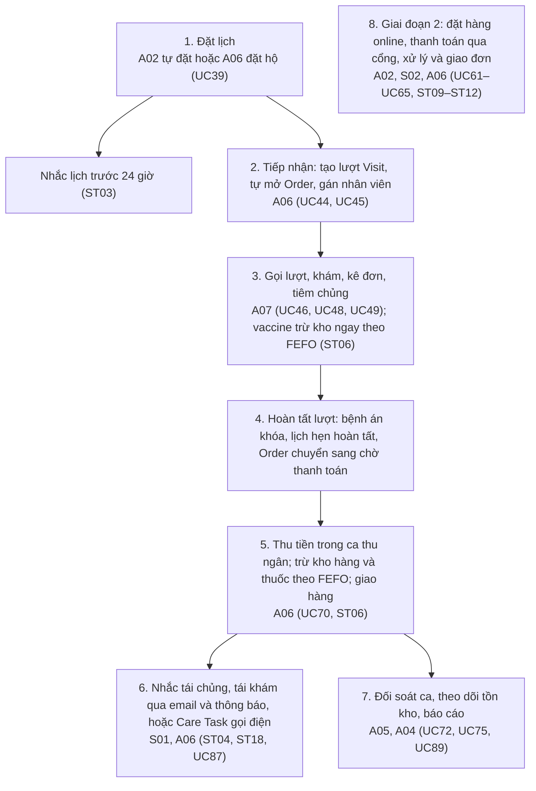
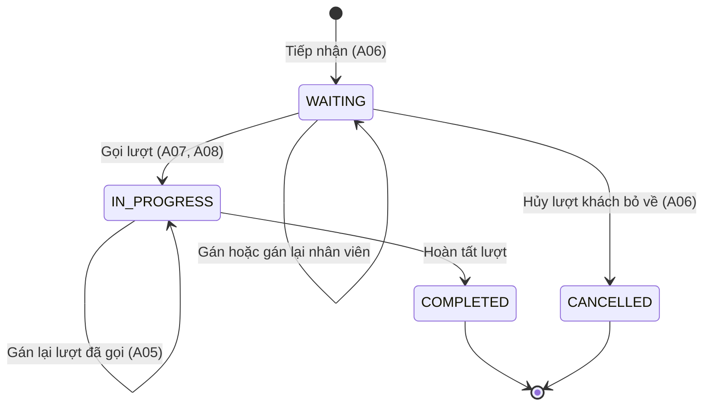
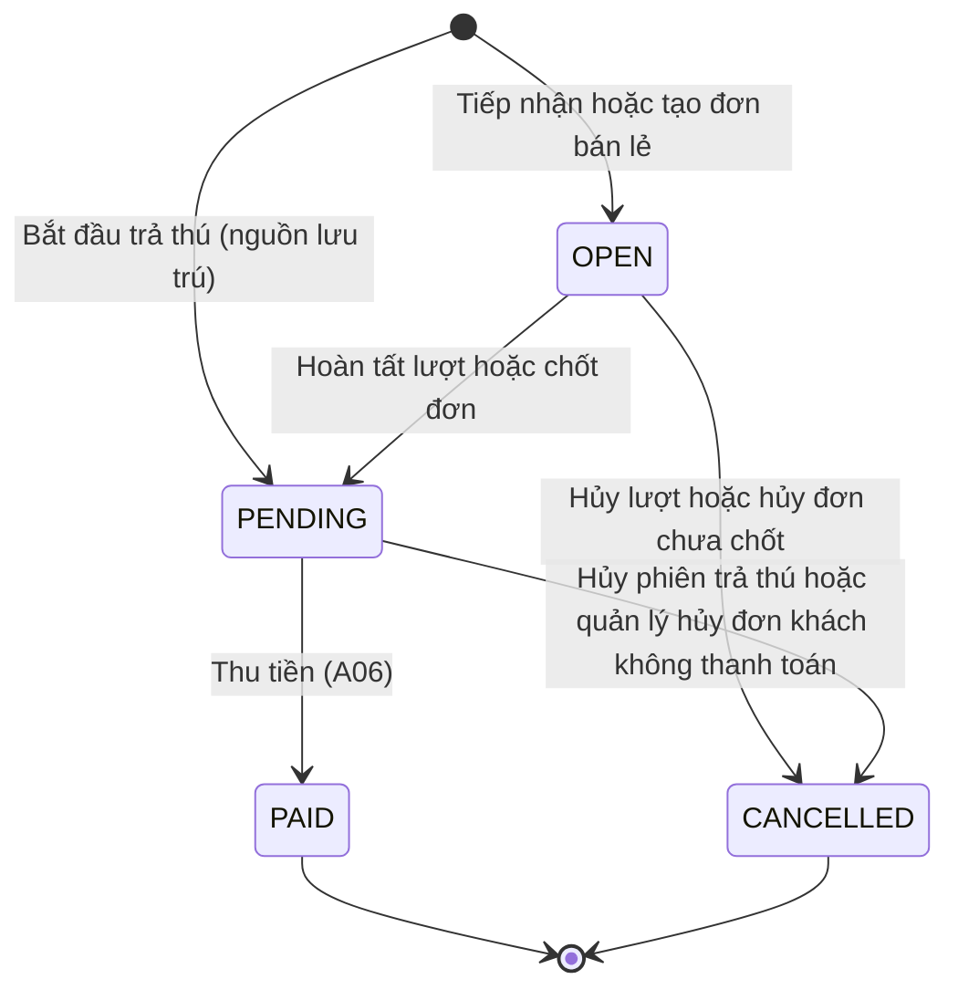
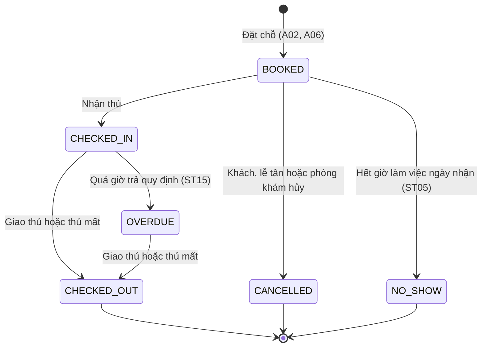
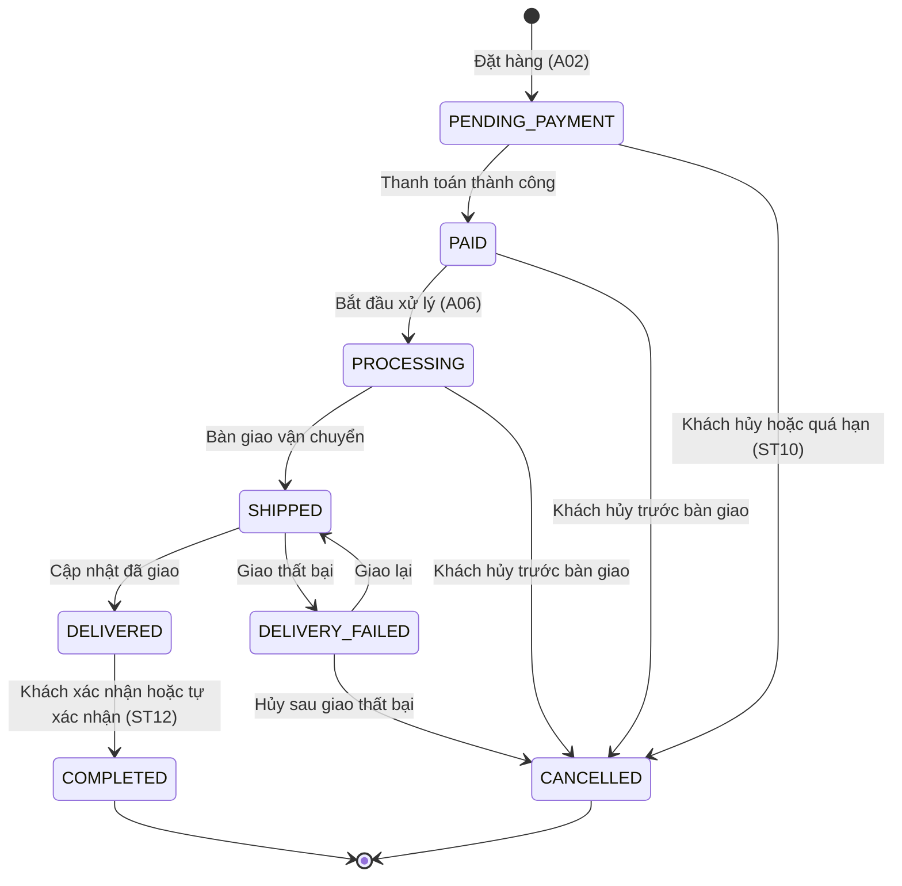
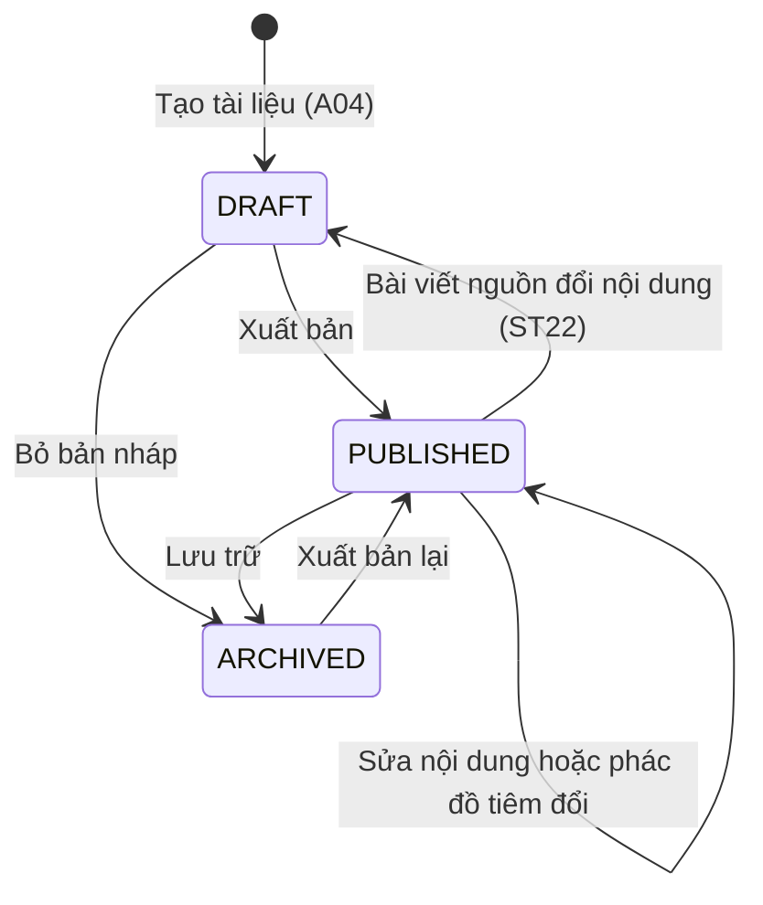
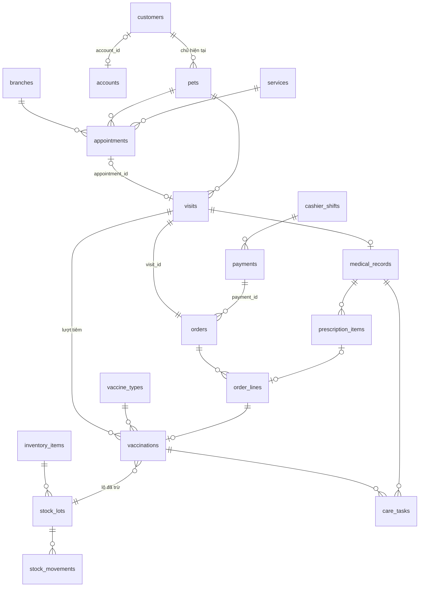

# Chương 2. Khảo sát và phân tích yêu cầu

> Trạng thái: **bản nháp đầy đủ** (T86-1, 18/11/2026). Số liệu: [`00-so-lieu.md`](./00-so-lieu.md), đo ngày 18/11/2026. Các bảng 2.3 và 2.4 được sinh tự động từ `docs/01` (xem mục TODO).

Chương này mô tả hệ thống **cần làm gì**, theo bộ đặc tả hiện hành (phiên bản v16 và các bổ sung của giai đoạn 2). Chương không nói phần nào đã cài đặt; việc đó ở mục 1.3.3 và chương 4.

## 2.1. Tác nhân của hệ thống

Hệ thống có 8 tác nhân người (A01–A08) và 3 tác nhân hệ thống (S01–S03). Nhân viên A05–A08 thuộc đúng một chi nhánh và chỉ thao tác trên dữ liệu của chi nhánh mình; ADMIN (A03) và quản lý chuỗi (A04) không gắn với chi nhánh nào. Hồ sơ khách hàng, thú cưng, danh mục sản phẩm và dịch vụ, nhà cung cấp dùng chung toàn chuỗi. Khách hàng chỉ truy cập được dữ liệu của chính mình.

**Bảng 2.1. Tác nhân và số use case (giai đoạn 1 + giai đoạn 2)**

| Mã | Tác nhân | Vai trò chính | Use case |
|---|---|---|---|
| A01 | Khách vãng lai (GUEST) | Chưa đăng nhập; xem thông tin công khai (dịch vụ, chi nhánh, bác sĩ, sản phẩm, bài viết), đăng ký tài khoản, hỏi chatbot. Muốn đặt lịch phải đăng ký tài khoản hoặc nhờ lễ tân đặt hộ | 6 (5 + 1) |
| A02 | Khách hàng (CUSTOMER) | Chủ thú cưng đã có tài khoản: hồ sơ cá nhân và thú cưng, đặt lịch khám và lưu trú, xem hồ sơ sức khỏe và nhật ký chăm sóc, nhận nhắc, gửi feedback. Giai đoạn 2: mua hàng và thanh toán trực tuyến, bình luận bài viết, chatbot và gợi ý | 25 (17 + 8) |
| A03 | Quản trị hệ thống (ADMIN) | Quản trị kỹ thuật: tạo tài khoản SUPER_MANAGER, khóa và mở khóa người dùng, tham số cấu hình, mẫu thông báo, xem audit. Không tham gia nghiệp vụ phòng khám và bán hàng | 10 (10 + 0) |
| A04 | Quản lý chuỗi (SUPER_MANAGER) | Cấp chuỗi, mọi chi nhánh: chi nhánh, danh mục sản phẩm và dịch vụ, loại vaccine và phác đồ, tài khoản nhân viên, nội dung trang, bài viết, feedback, báo cáo toàn chuỗi. Giai đoạn 2: tạm ngừng hoặc đóng chi nhánh, phí vận chuyển, duyệt bài viết của bác sĩ, quản lý tri thức chatbot | 20 (16 + 4) |
| A05 | Quản lý chi nhánh (BRANCH_MANAGER) | Một chi nhánh: nhân viên cấp dưới, giờ mở cửa, ngày nghỉ, quota lịch hẹn, dịch vụ tại chi nhánh, chuồng, kho, đối soát ca thu ngân, feedback và báo cáo chi nhánh. Giai đoạn 2: phân ca, duyệt nghỉ, gộp hồ sơ khách trùng, duyệt trả hàng, chuyển kho, kiểm kê, truy vết lô | 28 (20 + 8) |
| A06 | Lễ tân kiêm thu ngân (RECEPTIONIST) | Đầu mối vận hành hằng ngày tại quầy: hồ sơ khách, lịch hẹn, tiếp nhận, hàng đợi, bán hàng, thu tiền, nhận và trả thú lưu trú, Care Task. Giai đoạn 2: xử lý và giao đơn online, tạo yêu cầu trả hàng, lịch làm việc | 27 (23 + 4) |
| A07 | Bác sĩ thú y (VET) | Khám, chẩn đoán, kê đơn, tiêm chủng, hẹn tái khám, bổ sung bệnh án, ghi nhật ký chăm sóc; có hồ sơ giới thiệu công khai. Giai đoạn 2: nhập và xuất viện, điều trị nội trú, viết bài chuyên môn, truy vết lô, lịch làm việc | 20 (14 + 6) |
| A08 | Nhân viên chăm sóc (CARETAKER) | Dịch vụ thẩm mỹ (tắm, cắt tỉa), nhận thú lưu trú, ghi nhật ký chăm sóc; chỉ được xem bệnh án. Giai đoạn 2: lịch làm việc | 15 (13 + 2) |
| S01 | Hệ thống (System) | Tự chạy các tác vụ định kỳ và theo sự kiện: nhắc lịch, trừ kho, cảnh báo tồn kho, tự chốt ca, sinh Care Task, xử lý đơn online quá hạn… | 22 tác vụ (12 + 10) |
| S02 | Cổng thanh toán (Payment Gateway) | Giai đoạn 2: xử lý thanh toán và hoàn tiền trực tuyến, trả kết quả giao dịch về hệ thống | UC63; ST11, ST14, ST21 |
| S03 | Dịch vụ email và push | Gửi OTP, thông báo và nhắc lịch | Kênh gửi |

*Nguồn: `docs/01` mục 0; số use case đếm theo cột tác nhân của `docs/01` (Bảng S.1). Tổng các dòng A01–A08 là 151 vì một use case có thể thuộc nhiều tác nhân; số use case khác nhau là 85.*

## 2.2. Phân hệ và tác nhân quản lý trực tiếp

Mỗi phân hệ có **tác nhân quản lý trực tiếp** (chịu trách nhiệm chính về dữ liệu và nghiệp vụ: tạo lập, cấu hình, phê duyệt hoặc vận hành chính) và **tác nhân tham gia** (dùng một phần chức năng trong phạm vi được phép). Bảng 2.2 đi theo đề cương mục 2.2.3, đã loại các use case và tác vụ bị bỏ (UC43, UC50, UC51, UC85, UC86, ST16, ST17) và thêm phân hệ AI. Đây là quan hệ giữa phân hệ và tác nhân của hệ thống, không phải phân công của nhóm phát triển (mục 1.5).

**Bảng 2.2. Phân hệ và tác nhân**

| Mã | Phân hệ | Tác nhân quản lý trực tiếp | Tác nhân tham gia | Giai đoạn 2 bổ sung |
|---|---|---|---|---|
| TK | Tài khoản và xác thực | A02–A08 tự quản lý tài khoản của mình (UC03–UC06); A02 liên kết hồ sơ (UC07) | A01 đăng ký (UC01, UC02); A06 sửa email, khôi phục tài khoản, liên kết hồ sơ hộ khách tại quầy (UC22) | — |
| QT | Quản trị hệ thống | A03 (UC09, UC10, UC11; UC08 với SUPER_MANAGER) | A04, A05 quản lý tài khoản nhân viên cấp dưới (UC08) | — |
| CN | Chi nhánh | A04 (UC12); A05 với chi nhánh mình (UC14) | A01, A02 xem chi nhánh (UC15) | A04 tạm ngừng, đóng cửa chi nhánh (UC13) |
| CK | Thông tin công khai | A04 (UC21) | A01, A02 xem (UC15–UC17); A07 cập nhật hồ sơ giới thiệu công khai (UC06) | — |
| KH | Khách hàng và thú cưng | A06 (UC22, UC24, UC26) | A02 quản lý thú cưng của mình (UC24), xem hồ sơ sức khỏe (UC25); A06, A07, A08 tra cứu (UC23) | A05 gộp hồ sơ khách trùng (UC27) |
| SP | Sản phẩm và dịch vụ | A04 (UC28–UC31) | A05 bật hoặc tắt dịch vụ tại chi nhánh (UC33); A01, A02 xem (UC15, UC16) | A04 phí vận chuyển (UC32) và định mức vật tư của dịch vụ (UC30) |
| LH | Lịch hẹn | A06 (UC39, UC40); A05 thiết lập quota (UC42) | A02 tự đặt, đổi, hủy (UC39, UC40); S01 nhắc lịch, chuyển lịch sang không đến (ST03, ST05) | — |
| TN | Tiếp nhận và hàng đợi | A06 (UC44, UC45) | A05 gán lại lượt đã gọi (UC45); A07, A08 xem hàng đợi và gọi lượt (UC46); A07, A06 xác định ca cấp cứu (UC47) | — |
| KB | Khám và điều trị | A07 (UC48, UC49, UC53) | A08 thẩm mỹ, xem bệnh án (UC52, UC53); A02 xem hồ sơ sức khỏe (UC25) | S01 trừ vật tư tiêu hao (ST07) |
| LT | Lưu trú và nội trú | A05 quản lý chuồng (UC54); A06 đặt chỗ, nhận và trả thú (UC58, UC59) | A02 đặt chỗ, xem nhật ký (UC58, UC60); A08 nhận thú, ghi nhật ký (UC59, UC57); A07 ghi nhật ký (UC57); S01 (ST05, ST15) | A07 nhập và xuất viện (UC55), điều trị nội trú (UC56) |
| BH | Bán hàng và đơn hàng | A06 (UC66, UC67) | A05 hủy Order khách không thanh toán (UC66); A07, A08 thêm dịch vụ, thuốc vào Order (UC67) | A02 giỏ hàng, đặt hàng, thanh toán, đơn của tôi (UC61–UC64, cùng S02); A06 xử lý và giao đơn (UC65), tạo yêu cầu trả hàng (UC68); A05 duyệt trả hàng (UC69); S01 (ST09–ST12, ST21) |
| TG | Thu ngân | A06 (UC70, UC71) | A05 đối soát ca (UC72); S01 tự chốt ca (ST13) | S01 và S02 đối soát cổng thanh toán (ST14) |
| KO | Kho | A05 (UC73–UC76) | A06 xem tồn kho (UC75); S01 trừ kho theo FEFO, cảnh báo tồn (ST06, ST08) | A05 chuyển kho, kiểm kê (UC77, UC78); A05, A07 truy vết lô (UC79) |
| BV | Bài viết | A04 (UC81) | A01, A02 xem bài viết (UC17) | A07 soạn và gửi duyệt (UC80); A04 duyệt bài, ẩn bình luận (UC81); A02 bình luận (UC82) |
| DG | Feedback | A04 với mọi feedback; A05 với feedback chi nhánh mình (UC84) | A02 gửi feedback (UC83) | S01 dọn feedback quá hạn lưu (ST24) |
| TB | Chăm sóc khách hàng và thông báo | A06 thực hiện Care Task (UC87) | A02–A08 xem thông báo, A02 cài đặt nhận thông báo (UC88); A03 sửa mẫu thông báo (UC10); S01 (ST04, ST18–ST20) | — |
| BC | Báo cáo | A04 toàn chuỗi; A05 chi nhánh mình (UC89) | — | — |
| NS | Nhân sự | A05 (UC34, UC37, UC38) | A06, A07, A08 (UC35, UC36) | Toàn bộ phân hệ (giai đoạn 2) |
| AI | Trí tuệ nhân tạo | A04 quản lý tri thức chatbot và hồ sơ gợi ý (UC93, UC94) | A01, A02 hỏi đáp (UC90); A02 hỏi về lịch của tôi (UC91), xem gợi ý (UC92) | Toàn bộ phân hệ (giai đoạn 2) |

*Nguồn: đề cương mục 2.2.3; `docs/01` (A. Danh sách use case, B. Tác vụ hệ thống); ADR-0122, ADR-0124 (`0124-bo-kham-tai-nha`), ADR-0125.*

## 2.3. Use case theo từng tác nhân

Các bảng dưới liệt kê use case của từng tác nhân, lấy nguyên từ `docs/01`. Cột **Giai đoạn**: GĐ1 là giai đoạn 1; "GĐ2 (tầng 3)" là phần mở rộng của giai đoạn 2; "GĐ2 (AI)" là phân hệ trí tuệ nhân tạo.

<!--UC_BY_ACTOR:begin-->
### 2.3.1. A01 – Khách vãng lai (GUEST): 6 use case (5 + 1)

UC91 (hỏi chatbot về lịch của tôi) chỉ nhắc khách vãng lai đăng nhập nên không tính cho A01.

**Bảng 2.3a. Use case của A01**

| Mã | Use case | Phân hệ | Giai đoạn | Ghi chú |
|---|---|---|---|---|
| UC01 | Đăng ký tài khoản | Tài khoản & xác thực | GĐ1 |  |
| UC02 | Xác thực OTP | Tài khoản & xác thực | GĐ1 |  |
| UC15 | Xem dịch vụ, chi nhánh & đội ngũ bác sĩ | Thông tin công khai | GĐ1 |  |
| UC16 | Xem & tìm kiếm sản phẩm | Thông tin công khai | GĐ1 |  |
| UC17 | Xem bài viết | Thông tin công khai | GĐ1 |  |
| UC90 | Hỏi đáp chatbot tư vấn chăm sóc | Trí tuệ nhân tạo | GĐ2 (AI) |  |

### 2.3.2. A02 – Khách hàng (CUSTOMER): 25 use case (17 + 8)

**Bảng 2.3b. Use case của A02**

| Mã | Use case | Phân hệ | Giai đoạn | Ghi chú |
|---|---|---|---|---|
| UC02 | Xác thực OTP | Tài khoản & xác thực | GĐ1 |  |
| UC03 | Đăng nhập / đăng xuất | Tài khoản & xác thực | GĐ1 |  |
| UC04 | Quên mật khẩu | Tài khoản & xác thực | GĐ1 |  |
| UC05 | Đổi mật khẩu | Tài khoản & xác thực | GĐ1 |  |
| UC06 | Quản lý hồ sơ cá nhân | Tài khoản & xác thực | GĐ1 |  |
| UC07 | Liên kết tài khoản với hồ sơ khách có sẵn | Tài khoản & xác thực | GĐ1 |  |
| UC15 | Xem dịch vụ, chi nhánh & đội ngũ bác sĩ | Thông tin công khai | GĐ1 |  |
| UC16 | Xem & tìm kiếm sản phẩm | Thông tin công khai | GĐ1 |  |
| UC17 | Xem bài viết | Thông tin công khai | GĐ1 |  |
| UC24 | Quản lý thú cưng | Khách hàng & thú cưng | GĐ1 |  |
| UC25 | Xem hồ sơ sức khỏe thú cưng | Khách hàng & thú cưng | GĐ1 |  |
| UC39 | Đặt lịch hẹn | Lịch hẹn | GĐ1 | tự đặt |
| UC40 | Quản lý lịch hẹn | Lịch hẹn | GĐ1 |  |
| UC58 | Đặt chỗ lưu trú theo loại chuồng | Lưu trú & nội trú | GĐ1 | đặt, hủy, gia hạn |
| UC60 | Xem lưu trú & nhật ký chăm sóc của thú cưng | Lưu trú & nội trú | GĐ1 |  |
| UC61 | Quản lý giỏ hàng | Bán hàng & đơn hàng | GĐ2 (tầng 3) |  |
| UC62 | Đặt hàng online | Bán hàng & đơn hàng | GĐ2 (tầng 3) |  |
| UC63 | Thanh toán online | Bán hàng & đơn hàng | GĐ2 (tầng 3) |  |
| UC64 | Quản lý đơn hàng của tôi | Bán hàng & đơn hàng | GĐ2 (tầng 3) |  |
| UC82 | Bình luận bài viết | Bài viết | GĐ2 (tầng 3) |  |
| UC83 | Gửi feedback | Feedback | GĐ1 |  |
| UC88 | Xem thông báo & cài đặt nhận thông báo | Chăm sóc khách hàng & thông báo | GĐ1 | gồm cài đặt nhận thông báo |
| UC90 | Hỏi đáp chatbot tư vấn chăm sóc | Trí tuệ nhân tạo | GĐ2 (AI) |  |
| UC91 | Hỏi chatbot về lịch của tôi: lịch hẹn sắp tới, lịch tiêm của thú | Trí tuệ nhân tạo | GĐ2 (AI) |  |
| UC92 | Xem gợi ý cá nhân hóa cho thú | Trí tuệ nhân tạo | GĐ2 (AI) |  |

### 2.3.3. A03 – Quản trị hệ thống (ADMIN): 10 use case (10 + 0)

**Bảng 2.3c. Use case của A03**

| Mã | Use case | Phân hệ | Giai đoạn | Ghi chú |
|---|---|---|---|---|
| UC02 | Xác thực OTP | Tài khoản & xác thực | GĐ1 |  |
| UC03 | Đăng nhập / đăng xuất | Tài khoản & xác thực | GĐ1 |  |
| UC04 | Quên mật khẩu | Tài khoản & xác thực | GĐ1 |  |
| UC05 | Đổi mật khẩu | Tài khoản & xác thực | GĐ1 |  |
| UC06 | Quản lý hồ sơ cá nhân | Tài khoản & xác thực | GĐ1 |  |
| UC08 | Quản lý tài khoản nhân viên | Quản trị hệ thống | GĐ1 | tạo tài khoản SUPER_MANAGER |
| UC09 | Khóa / mở khóa người dùng | Quản trị hệ thống | GĐ1 |  |
| UC10 | Cấu hình tham số hệ thống & mẫu thông báo | Quản trị hệ thống | GĐ1 |  |
| UC11 | Xem nhật ký audit | Quản trị hệ thống | GĐ1 |  |
| UC88 | Xem thông báo & cài đặt nhận thông báo | Chăm sóc khách hàng & thông báo | GĐ1 | chỉ xem thông báo |

### 2.3.4. A04 – Quản lý chuỗi (SUPER_MANAGER): 20 use case (16 + 4)

**Bảng 2.3d. Use case của A04**

| Mã | Use case | Phân hệ | Giai đoạn | Ghi chú |
|---|---|---|---|---|
| UC02 | Xác thực OTP | Tài khoản & xác thực | GĐ1 |  |
| UC03 | Đăng nhập / đăng xuất | Tài khoản & xác thực | GĐ1 |  |
| UC04 | Quên mật khẩu | Tài khoản & xác thực | GĐ1 |  |
| UC05 | Đổi mật khẩu | Tài khoản & xác thực | GĐ1 |  |
| UC06 | Quản lý hồ sơ cá nhân | Tài khoản & xác thực | GĐ1 |  |
| UC08 | Quản lý tài khoản nhân viên | Quản trị hệ thống | GĐ1 | phạm vi theo BR-QT-01, BR-QT-07 |
| UC12 | Quản lý chi nhánh | Chi nhánh | GĐ1 |  |
| UC13 | Tạm ngừng / đóng cửa chi nhánh | Chi nhánh | GĐ2 (tầng 3) |  |
| UC21 | Quản lý nội dung trang | Thông tin công khai | GĐ1 |  |
| UC28 | Quản lý danh mục sản phẩm | Sản phẩm & dịch vụ | GĐ1 |  |
| UC29 | Quản lý sản phẩm | Sản phẩm & dịch vụ | GĐ1 |  |
| UC30 | Quản lý dịch vụ | Sản phẩm & dịch vụ | GĐ1 |  |
| UC31 | Quản lý loại vaccine & phác đồ tiêm chủng | Sản phẩm & dịch vụ | GĐ1 |  |
| UC32 | Cấu hình phí vận chuyển | Sản phẩm & dịch vụ | GĐ2 (tầng 3) |  |
| UC81 | Quản lý bài viết, chuyên mục & bình luận | Bài viết | GĐ1 |  |
| UC84 | Xem feedback | Feedback | GĐ1 | toàn chuỗi |
| UC88 | Xem thông báo & cài đặt nhận thông báo | Chăm sóc khách hàng & thông báo | GĐ1 | chỉ xem thông báo |
| UC89 | Xem báo cáo | Báo cáo | GĐ1 | toàn chuỗi |
| UC93 | Quản lý tri thức chatbot | Trí tuệ nhân tạo | GĐ2 (AI) |  |
| UC94 | Khai báo hồ sơ gợi ý của dịch vụ / sản phẩm | Trí tuệ nhân tạo | GĐ2 (AI) |  |

### 2.3.5. A05 – Quản lý chi nhánh (BRANCH_MANAGER): 28 use case (20 + 8)

**Bảng 2.3e. Use case của A05**

| Mã | Use case | Phân hệ | Giai đoạn | Ghi chú |
|---|---|---|---|---|
| UC02 | Xác thực OTP | Tài khoản & xác thực | GĐ1 |  |
| UC03 | Đăng nhập / đăng xuất | Tài khoản & xác thực | GĐ1 |  |
| UC04 | Quên mật khẩu | Tài khoản & xác thực | GĐ1 |  |
| UC05 | Đổi mật khẩu | Tài khoản & xác thực | GĐ1 |  |
| UC06 | Quản lý hồ sơ cá nhân | Tài khoản & xác thực | GĐ1 |  |
| UC08 | Quản lý tài khoản nhân viên | Quản trị hệ thống | GĐ1 | chỉ nhân viên cấp dưới trong chi nhánh mình |
| UC14 | Cấu hình giờ mở cửa & ngày nghỉ | Chi nhánh | GĐ1 |  |
| UC27 | Gộp hồ sơ khách trùng | Khách hàng & thú cưng | GĐ2 (tầng 3) |  |
| UC33 | Bật / tắt dịch vụ tại chi nhánh | Sản phẩm & dịch vụ | GĐ1 |  |
| UC34 | Quản lý ca làm việc | Nhân sự | GĐ2 (tầng 3) |  |
| UC37 | Duyệt yêu cầu nghỉ, đổi ca | Nhân sự | GĐ2 (tầng 3) |  |
| UC38 | Ghi nhận vắng đột xuất | Nhân sự | GĐ2 (tầng 3) |  |
| UC42 | Thiết lập quota lịch hẹn | Lịch hẹn | GĐ1 |  |
| UC45 | Điều phối hàng đợi | Tiếp nhận & hàng đợi | GĐ1 | chỉ gán lại lượt đã gọi khi người phụ trách bị khóa |
| UC54 | Quản lý chuồng | Lưu trú & nội trú | GĐ1 |  |
| UC66 | Bán hàng & chốt Order tại quầy | Bán hàng & đơn hàng | GĐ1 | hủy Order chờ thanh toán của khách không trả (BR-BH-05) |
| UC69 | Duyệt yêu cầu trả hàng | Bán hàng & đơn hàng | GĐ2 (tầng 3) |  |
| UC72 | Đối soát ca thu ngân | Thu ngân | GĐ1 |  |
| UC73 | Quản lý nhà cung cấp | Kho | GĐ1 |  |
| UC74 | Nhập kho | Kho | GĐ1 |  |
| UC75 | Xem tồn kho & thiết lập tồn tối thiểu | Kho | GĐ1 |  |
| UC76 | Điều chỉnh tồn kho | Kho | GĐ1 |  |
| UC77 | Chuyển kho | Kho | GĐ2 (tầng 3) |  |
| UC78 | Kiểm kê kho | Kho | GĐ2 (tầng 3) |  |
| UC79 | Truy vết lô hàng | Kho | GĐ2 (tầng 3) |  |
| UC84 | Xem feedback | Feedback | GĐ1 | chỉ chi nhánh mình |
| UC88 | Xem thông báo & cài đặt nhận thông báo | Chăm sóc khách hàng & thông báo | GĐ1 | chỉ xem thông báo |
| UC89 | Xem báo cáo | Báo cáo | GĐ1 | chỉ chi nhánh mình |

### 2.3.6. A06 – Lễ tân kiêm thu ngân (RECEPTIONIST): 27 use case (23 + 4)

**Bảng 2.3f. Use case của A06**

| Mã | Use case | Phân hệ | Giai đoạn | Ghi chú |
|---|---|---|---|---|
| UC02 | Xác thực OTP | Tài khoản & xác thực | GĐ1 |  |
| UC03 | Đăng nhập / đăng xuất | Tài khoản & xác thực | GĐ1 |  |
| UC04 | Quên mật khẩu | Tài khoản & xác thực | GĐ1 |  |
| UC05 | Đổi mật khẩu | Tài khoản & xác thực | GĐ1 |  |
| UC06 | Quản lý hồ sơ cá nhân | Tài khoản & xác thực | GĐ1 |  |
| UC22 | Quản lý hồ sơ khách tại quầy | Khách hàng & thú cưng | GĐ1 |  |
| UC23 | Tra cứu khách & thú cưng | Khách hàng & thú cưng | GĐ1 |  |
| UC24 | Quản lý thú cưng | Khách hàng & thú cưng | GĐ1 |  |
| UC26 | Chuyển chủ thú cưng | Khách hàng & thú cưng | GĐ1 |  |
| UC35 | Xem lịch làm việc của tôi và đăng ký ca theo tuần | Nhân sự | GĐ2 (tầng 3) |  |
| UC36 | Gửi / rút yêu cầu nghỉ, đổi ca | Nhân sự | GĐ2 (tầng 3) |  |
| UC39 | Đặt lịch hẹn | Lịch hẹn | GĐ1 | đặt hộ khách |
| UC40 | Quản lý lịch hẹn | Lịch hẹn | GĐ1 |  |
| UC44 | Tiếp nhận khách | Tiếp nhận & hàng đợi | GĐ1 |  |
| UC45 | Điều phối hàng đợi | Tiếp nhận & hàng đợi | GĐ1 |  |
| UC47 | Xác định ca cấp cứu | Tiếp nhận & hàng đợi | GĐ1 | cùng A07 |
| UC58 | Đặt chỗ lưu trú theo loại chuồng | Lưu trú & nội trú | GĐ1 | đặt, hủy, gia hạn |
| UC59 | Nhận / trả thú cưng lưu trú | Lưu trú & nội trú | GĐ1 |  |
| UC65 | Xử lý & giao đơn online | Bán hàng & đơn hàng | GĐ2 (tầng 3) |  |
| UC66 | Bán hàng & chốt Order tại quầy | Bán hàng & đơn hàng | GĐ1 |  |
| UC67 | Thêm dịch vụ / hàng vào Order | Bán hàng & đơn hàng | GĐ1 |  |
| UC68 | Tạo yêu cầu trả hàng | Bán hàng & đơn hàng | GĐ2 (tầng 3) |  |
| UC70 | Thu tiền tại quầy | Thu ngân | GĐ1 |  |
| UC71 | Mở / chốt ca thu ngân | Thu ngân | GĐ1 |  |
| UC75 | Xem tồn kho & thiết lập tồn tối thiểu | Kho | GĐ1 | chỉ xem |
| UC87 | Thực hiện Care Task | Chăm sóc khách hàng & thông báo | GĐ1 |  |
| UC88 | Xem thông báo & cài đặt nhận thông báo | Chăm sóc khách hàng & thông báo | GĐ1 | chỉ xem thông báo |

### 2.3.7. A07 – Bác sĩ thú y (VET): 20 use case (14 + 6)

**Bảng 2.3g. Use case của A07**

| Mã | Use case | Phân hệ | Giai đoạn | Ghi chú |
|---|---|---|---|---|
| UC02 | Xác thực OTP | Tài khoản & xác thực | GĐ1 |  |
| UC03 | Đăng nhập / đăng xuất | Tài khoản & xác thực | GĐ1 |  |
| UC04 | Quên mật khẩu | Tài khoản & xác thực | GĐ1 |  |
| UC05 | Đổi mật khẩu | Tài khoản & xác thực | GĐ1 |  |
| UC06 | Quản lý hồ sơ cá nhân | Tài khoản & xác thực | GĐ1 | gồm hồ sơ giới thiệu hiển thị công khai |
| UC23 | Tra cứu khách & thú cưng | Khách hàng & thú cưng | GĐ1 |  |
| UC35 | Xem lịch làm việc của tôi và đăng ký ca theo tuần | Nhân sự | GĐ2 (tầng 3) |  |
| UC36 | Gửi / rút yêu cầu nghỉ, đổi ca | Nhân sự | GĐ2 (tầng 3) |  |
| UC46 | Xem hàng đợi của tôi & gọi lượt | Tiếp nhận & hàng đợi | GĐ1 |  |
| UC47 | Xác định ca cấp cứu | Tiếp nhận & hàng đợi | GĐ1 | xác định ca cấp cứu |
| UC48 | Khám bệnh | Khám & điều trị | GĐ1 |  |
| UC49 | Tiêm chủng | Khám & điều trị | GĐ1 |  |
| UC53 | Xem & bổ sung bệnh án | Khám & điều trị | GĐ1 |  |
| UC55 | Nhập / xuất viện | Lưu trú & nội trú | GĐ2 (tầng 3) |  |
| UC56 | Điều trị nội trú | Lưu trú & nội trú | GĐ2 (tầng 3) |  |
| UC57 | Ghi nhật ký chăm sóc | Lưu trú & nội trú | GĐ1 |  |
| UC67 | Thêm dịch vụ / hàng vào Order | Bán hàng & đơn hàng | GĐ1 |  |
| UC79 | Truy vết lô hàng | Kho | GĐ2 (tầng 3) |  |
| UC80 | Soạn & gửi duyệt bài viết | Bài viết | GĐ2 (tầng 3) |  |
| UC88 | Xem thông báo & cài đặt nhận thông báo | Chăm sóc khách hàng & thông báo | GĐ1 | chỉ xem thông báo |

### 2.3.8. A08 – Nhân viên chăm sóc (CARETAKER): 15 use case (13 + 2)

**Bảng 2.3h. Use case của A08**

| Mã | Use case | Phân hệ | Giai đoạn | Ghi chú |
|---|---|---|---|---|
| UC02 | Xác thực OTP | Tài khoản & xác thực | GĐ1 |  |
| UC03 | Đăng nhập / đăng xuất | Tài khoản & xác thực | GĐ1 |  |
| UC04 | Quên mật khẩu | Tài khoản & xác thực | GĐ1 |  |
| UC05 | Đổi mật khẩu | Tài khoản & xác thực | GĐ1 |  |
| UC06 | Quản lý hồ sơ cá nhân | Tài khoản & xác thực | GĐ1 |  |
| UC23 | Tra cứu khách & thú cưng | Khách hàng & thú cưng | GĐ1 |  |
| UC35 | Xem lịch làm việc của tôi và đăng ký ca theo tuần | Nhân sự | GĐ2 (tầng 3) |  |
| UC36 | Gửi / rút yêu cầu nghỉ, đổi ca | Nhân sự | GĐ2 (tầng 3) |  |
| UC46 | Xem hàng đợi của tôi & gọi lượt | Tiếp nhận & hàng đợi | GĐ1 |  |
| UC52 | Thực hiện dịch vụ thẩm mỹ | Khám & điều trị | GĐ1 |  |
| UC53 | Xem & bổ sung bệnh án | Khám & điều trị | GĐ1 | chỉ xem |
| UC57 | Ghi nhật ký chăm sóc | Lưu trú & nội trú | GĐ1 |  |
| UC59 | Nhận / trả thú cưng lưu trú | Lưu trú & nội trú | GĐ1 | chỉ nhận thú |
| UC67 | Thêm dịch vụ / hàng vào Order | Bán hàng & đơn hàng | GĐ1 |  |
| UC88 | Xem thông báo & cài đặt nhận thông báo | Chăm sóc khách hàng & thông báo | GĐ1 | chỉ xem thông báo |

<!--UC_BY_ACTOR:end-->

## 2.4. Tác vụ hệ thống tự động (tác nhân S01)

Tác vụ hệ thống do hệ thống tự chạy theo thời gian hoặc theo sự kiện, không phải mục tiêu của một tác nhân người. Mỗi tác vụ có mã `ST<số>`.

**Bảng 2.4. Tác vụ hệ thống**

<!--ST_TABLE:begin-->
| Mã | Tác vụ | Kích hoạt hoặc liên quan | Giai đoạn |
|---|---|---|---|
| ST01 | Khóa tạm tài khoản do đăng nhập sai | UC03 | GĐ1 |
| ST02 | Dọn tài khoản chưa xác thực | Định kỳ | GĐ1 |
| ST03 | Nhắc lịch hẹn | Định kỳ | GĐ1 |
| ST04 | Nhắc tái chủng & nhắc tái khám | Định kỳ, dựa trên UC31, UC48, UC49 | GĐ1 |
| ST05 | Chuyển lịch hẹn & đặt chỗ lưu trú sang NO_SHOW | Định kỳ | GĐ1 |
| ST06 | Giữ hàng (đơn online) & trừ kho theo FEFO (vaccine khi tiêm; hàng, thuốc khi Order `PAID`) | UC49 (vaccine), UC62, UC65, UC66, UC70 | GĐ1 |
| ST07 | Trừ vật tư tiêu hao | UC48, UC52 | GĐ2 (tầng 3) |
| ST08 | Cảnh báo tồn kho dưới ngưỡng & lô sắp / đã hết hạn | Định kỳ | GĐ1 |
| ST09 | Tính phí vận chuyển | UC62, dùng cấu hình phí từ UC32 | GĐ2 (tầng 3) |
| ST10 | Hủy đơn chưa thanh toán | Định kỳ | GĐ2 (tầng 3) |
| ST11 | Hết hạn giao dịch thanh toán | Định kỳ | GĐ2 (tầng 3) |
| ST12 | Tự xác nhận đã nhận hàng | Định kỳ | GĐ2 (tầng 3) |
| ST13 | Tự chốt ca thu ngân chưa chốt & cảnh báo Order `PENDING` quá hạn | Ca thường: cuối ngày, theo giờ đóng cửa chi nhánh. Ca ngoài giờ: khi đến giờ mở cửa kế tiếp của chi nhánh | GĐ1 |
| ST14 | Đối soát cổng thanh toán | Hằng ngày | GĐ2 (tầng 3) |
| ST15 | Đánh dấu lưu trú quá hạn đón (OVERDUE) | Định kỳ | GĐ1 |
| ST18 | Sinh Care Task | ST04 (nhắc tái chủng / tái khám với hồ sơ không có email; quá hạn tái chủng), ST15 (quá hạn đón) | GĐ1 |
| ST19 | Tự hủy Care Task khi thú cưng đã mất | UC24 | GĐ1 |
| ST20 | Gửi thông báo & thử lại khi thất bại | Mọi sự kiện cần thông báo | GĐ1 |
| ST21 | Hoàn tiền online qua cổng thanh toán | UC64, UC69 | GĐ2 (tầng 3) |
| ST22 | Nạp lại chỉ mục tri thức AI (chia đoạn, nhúng vector; đồng bộ phác đồ tiêm) | UC93, định kỳ | GĐ2 (AI) |
| ST23 | Xóa nhật ký hỏi đáp AI quá hạn lưu | Hằng ngày | GĐ2 (AI) |
| ST24 | Dọn feedback quá hạn lưu (xóa cứng sau 30 ngày, BR-DG-05) | Hằng ngày | GĐ2 (tầng 3) |
<!--ST_TABLE:end-->

*Mã ST16 và ST17 (leo thang và tự đóng khiếu nại) đã bỏ cùng khiếu nại (ADR-0122); mã được giữ để không lệch số.*

## 2.5. Luồng nghiệp vụ chính

Hình 2.1 tóm tắt luồng vận hành chính của một chi nhánh, từ lúc khách đặt lịch đến khi nhắc tái chủng, cộng thêm luồng bán hàng trực tuyến của giai đoạn 2.

**Hình 2.1. Luồng nghiệp vụ chính.** *Nguồn: đề cương mục 2.2.7; `docs/01`; `docs/03` phụ lục.*

1. **Đặt lịch.** Khách hàng (A02) đặt lịch trực tuyến, hoặc lễ tân (A06) đặt hộ (UC39). Hệ thống nhắc lịch trước 24 giờ (ST03).
2. **Tiếp nhận.** Lễ tân tiếp nhận khách, tạo lượt tiếp nhận (Visit); hệ thống tự mở Order kèm dòng dịch vụ; lễ tân gán nhân viên phụ trách (UC44, UC45).
3. **Khám và tiêm.** Bác sĩ (A07) gọi lượt, khám, kê đơn, tiêm chủng. Vaccine được trừ kho ngay theo FEFO, nghĩa là hết hạn trước, xuất trước (UC46, UC48, UC49, ST06).
4. **Hoàn tất lượt.** Bệnh án bị khóa, lịch hẹn chuyển sang hoàn tất, Order chuyển sang chờ thanh toán.
5. **Thu tiền.** Lễ tân thu tiền trong ca thu ngân; kho trừ hàng và thuốc theo FEFO; khách nhận hàng (UC70, ST06).
6. **Nhắc tái chủng, tái khám.** Hệ thống nhắc qua email và thông báo trong ứng dụng; với hồ sơ khách không có email thì sinh Care Task để lễ tân gọi điện (ST04, ST18, UC87).
7. **Quản lý.** Quản lý chi nhánh (A05) đối soát ca thu ngân, theo dõi tồn kho và báo cáo chi nhánh; quản lý chuỗi (A04) xem báo cáo toàn chuỗi (UC72, UC75, UC89).
8. **Bán hàng trực tuyến (giai đoạn 2).** Khách đặt hàng và thanh toán qua cổng thanh toán (S02); lễ tân của chi nhánh xử lý và giao đơn; hệ thống tính phí vận chuyển, tự hủy đơn chưa thanh toán quá hạn và tự xác nhận đã nhận hàng (UC61–UC65, ST09–ST12).

## 2.6. Quy tắc nghiệp vụ tiêu biểu

Bộ đặc tả có 229 quy tắc nghiệp vụ, mỗi quy tắc mang mã `BR-<phân hệ>-<số>` (Bảng S.1). Bảng 2.5 chọn các quy tắc tiêu biểu; cột cuối nêu lý do chọn. Các giá trị đánh dấu *tham số* là tham số cấu hình do ADMIN đổi được qua UC10 (BR-QT-13); con số trong bảng là mặc định.

**Bảng 2.5. Quy tắc nghiệp vụ tiêu biểu**

| Mã | Nội dung | Vì sao chọn |
|---|---|---|
| BR-TK-01 | Email là định danh duy nhất của tài khoản, được xác thực bằng OTP. Số điện thoại không phải định danh, không duy nhất | Quyết định nền của mô hình tài khoản; ảnh hưởng đăng ký, tra cứu, liên kết hồ sơ khách tại quầy |
| BR-TK-09 | Sai mật khẩu 5 lần liên tiếp trong 15 phút (tham số) thì tài khoản bị khóa tạm 15 phút; chủ tài khoản nhận email cảnh báo (ST01) | Biện pháp chống dò mật khẩu, có tham số chỉnh được |
| BR-QT-01 | ADMIN tạo SUPER_MANAGER; SUPER_MANAGER tạo quản lý chi nhánh, lễ tân, bác sĩ, nhân viên chăm sóc; quản lý chi nhánh chỉ tạo ba vai trò sau trong chi nhánh mình. Yêu cầu vượt quyền bị từ chối (403) và ghi audit | Thể hiện phân quyền theo vai trò và theo chi nhánh |
| BR-KH-10 | Tra cứu khách theo SĐT, họ tên, email hoặc tên thú; một SĐT có thể ra nhiều hồ sơ. Tạo hồ sơ hoặc sửa SĐT thành số đã có thì cảnh báo nghi trùng, không chặn | Hệ quả của BR-TK-01; ảnh hưởng thao tác hằng ngày của lễ tân |
| BR-LH-03 | Quota lịch hẹn tính theo chi nhánh × nhóm dịch vụ × khung giờ, cấu hình hai mức (mặc định và riêng cho một khung, đặt 0 để khóa khung). Giảm quota không ảnh hưởng lịch đã đặt | Cơ chế kiểm soát tải của đặt lịch |
| BR-LH-09 | 3 lần không đến hoặc hủy muộn trong 90 ngày (tham số) thì khách bị hạn chế đặt online 30 ngày, chỉ đặt qua lễ tân; tính cả lịch hẹn và đặt chỗ lưu trú | Nối lịch hẹn, lưu trú và tác vụ ST05 |
| BR-KB-01 | Mỗi lượt khám hoặc tiêm có một bệnh án. Khi lượt hoàn tất, bệnh án khóa; mọi thay đổi sau đó là bản bổ sung ghi người, thời điểm, nội dung, không sửa hay xóa nội dung cũ | Toàn vẹn dữ liệu y tế; trả lời sai sót "sửa bệnh án không để lại dấu vết" ở mục tiêu 2 |
| BR-KB-04 | VET chọn loại vaccine theo phác đồ của loài; gợi ý mũi kế tiếp chỉ dựa trên lịch sử tiêm **tại hệ thống** (mũi tiêm nơi khác không được ghi nhận vì không kiểm chứng được); sản phẩm vaccine phải còn tồn khả dụng | Nền của hồ sơ tiêm chủng, nhắc tái chủng, điều kiện lưu trú |
| BR-BH-03 | Đơn giá được chốt tại thời điểm thêm dòng vào Order; đổi giá sau đó không ảnh hưởng dòng của Order chưa thanh toán | Bảo đảm tính đúng tiền |
| BR-BH-04, BR-KO-01, BR-KO-05 | Tồn kho theo chi nhánh × sản phẩm và theo lô, không bao giờ âm. Kho chỉ bị trừ khi Order chuyển sang đã thanh toán, theo FEFO, không bao giờ xuất lô hết hạn; kiểm tra và trừ kho trong cùng một giao dịch để không âm khi nhiều quầy thu đồng thời | Trả lời "tồn kho âm" và "xuất lô hết hạn" ở mục tiêu 2; ví dụ rõ về đồng thời |
| BR-TG-01, BR-BH-06 | Chỉ thu tiền khi lễ tân có ca thu ngân đang mở của chính mình và Order ở trạng thái chờ thanh toán. Thuốc và sản phẩm chỉ giao khi Order đã thanh toán; dịch vụ khám, tiêm, thẩm mỹ thực hiện trước, thu sau | Trả lời "thu tiền ngoài ca" và "giao hàng khi chưa thanh toán" |
| BR-TG-05 | Mỗi lễ tân có tối đa một ca đang mở. Ca thường mở trong giờ mở cửa; ca chưa chốt sau giờ đóng cửa cuối ngày cộng 30 phút (tham số) bị hệ thống tự chốt (ST13). Ca ngoài giờ chỉ mở ở chi nhánh có cờ nhận cấp cứu | Ràng buộc quanh ca thu ngân, có tác vụ tự động |
| BR-LT-03, BR-LT-05 | Với mỗi đêm lưu trú, số đặt chỗ đang chiếm chỗ của loại chuồng không vượt sức chứa. Khi nhận thú, thú phải có đủ các mũi tiêm bắt buộc khi lưu trú ghi nhận tại hệ thống và chưa quá hạn tái chủng | Hai ràng buộc chính của lưu trú; nối lưu trú với tiêm chủng |
| BR-LT-09 | Chỉ lễ tân được trả thú vì phải thu tiền trong ca; hệ thống sinh Order lưu trú, tính số đêm (tối thiểu 1, trả sau giờ quy định tính thêm 1 đêm); chỉ giao thú khi Order đã thanh toán | Nối lưu trú với thu ngân |
| BR-TB-02 | Khách có tài khoản nhận email và thông báo trong ứng dụng; hồ sơ tại quầy có email nhận email; hồ sơ tại quầy không có email thì sinh Care Task gọi điện cho lễ tân của chi nhánh phụ trách | Cách hệ thống không bỏ sót khách không dùng email |
| BR-DG-05 | Feedback bị xóa cứng sau 30 ngày (tham số) kể từ lúc tạo | Kết quả điều chỉnh của ADR-0122; là ngoại lệ của nguyên tắc không xóa cứng |
| BR-BH-08, BR-BH-09 | Giai đoạn 2. Đơn online đặt từ giỏ, chọn một chi nhánh xử lý còn đủ hàng cho mọi dòng, thanh toán chỉ online. Đặt xong thì giữ hàng; thanh toán thành công mới xuất kho theo FEFO; hủy hoặc quá hạn thì nhả hàng | Đặc trưng của thương mại điện tử: giữ hàng |
| BR-TG-08 | Giai đoạn 2. Số tiền cổng báo phải bằng số tiền giao dịch; lệch thì giao dịch thất bại và đưa vào đối soát xử lý tay, không tự đánh dấu đơn đã trả | Phòng sai lệch tiền khi thanh toán trực tuyến |
| BR-AI-14 | Tài liệu tri thức nhập tay chỉ được xuất bản khi đủ **hai lớp kiểm soát tách biệt**: nguồn tham khảo, và tên cùng ngày rà soát của bác sĩ thú y. Thiếu một lớp thì không xuất bản | Cách đặc tả bảo đảm nội dung chatbot có người chịu trách nhiệm. Lưu ý: người rà soát trong kho hiện tại là nhãn giả định (chương 6) |
| BR-AI-12 | Trước khi nhúng và trước khi gọi mô hình ngôn ngữ, hệ thống che email, số điện thoại và dãy 9 hoặc 12 chữ số trong câu hỏi; ở chat cá nhân còn che tên thú | Bảo vệ dữ liệu cá nhân khi dùng nhà cung cấp AI bên ngoài |
| BR-AI-03 | Câu hỏi có dấu hiệu cấp cứu thì không gọi mô hình ngôn ngữ; trả cảnh báo cố định kèm các chi nhánh nhận cấp cứu ngoài giờ | An toàn của chatbot |
| BR-AI-10 | AI lỗi hoặc quá 15 giây (tham số) thì trả trạng thái không khả dụng ở HTTP 200 kèm gợi ý đặt lịch; không chặn trang | Khả dụng: lỗi AI không kéo theo lỗi của trang |

*Nguồn: `docs/02` (các mã BR-TK, BR-QT, BR-KH, BR-LH, BR-KB, BR-BH, BR-TG, BR-KO, BR-LT, BR-TB, BR-DG); `docs/04` nguyên tắc xuyên suốt; `docs/07` mục 4 (BR-AI); `docs/08` (BR-BH-08, 09; BR-TG-08).*

## 2.7. Máy trạng thái

Đối tượng nào có vòng đời nghiệp vụ thì có một máy trạng thái hữu hạn (FSM). Mỗi FSM có bảng **chuyển trạng thái hợp lệ** (whitelist): chuyển nào không có trong bảng thì bị từ chối. Mỗi dòng của bảng ghi rõ người kích hoạt (tác nhân hoặc hệ thống), điều kiện và hệ quả kéo theo. Hệ thống có 23 máy trạng thái (Bảng S.1), liệt kê ở Bảng 2.6.

**Bảng 2.6. Các máy trạng thái**

| # | Đối tượng | Phân hệ | Giai đoạn | Số chuyển |
|---|---|---|---|---|
| 1 | Tài khoản | TK, QT | GĐ1 | 8 |
| 2 | Chi nhánh | CN | GĐ1 | 2 |
| 3 | Lịch hẹn | LH | GĐ1 | 8 |
| 4 | Lượt tiếp nhận (Visit) | TN, KB | GĐ1 | 6 |
| 5 | Order | BH, TG | GĐ1 | 10 |
| 6 | Đặt chỗ lưu trú | LT | GĐ1 | 11 |
| 7 | Chuồng | LT | GĐ1 | 5 |
| 8 | Ca thu ngân | TG | GĐ1 | 6 |
| 9 | Phiếu nhập kho | KO | GĐ1 | 4 |
| 10 | Care Task | TB | GĐ1 | 6 |
| 11 | Yêu cầu nghỉ hoặc đổi ca | NS | GĐ2 | 5 |
| 12 | Phân ca | NS | GĐ2 | 7 |
| 13 | Tài liệu tri thức AI | AI | GĐ2 | 8 |
| 14 | Đơn hàng online | BH | GĐ2 | 13 |
| 15 | Giao dịch thanh toán online | TG | GĐ2 | 5 |
| 16 | Yêu cầu trả hàng | BH | GĐ2 | 6 |
| 17 | Hoàn tiền | TG | GĐ2 | 5 |
| 18 | Phiếu chuyển kho | KO | GĐ2 | 3 |
| 19 | Phiên kiểm kê | KO | GĐ2 | 3 |
| 20 | Chi nhánh (mở rộng #2) | CN | GĐ2 | 4 |
| 21 | Bài viết (mở rộng) | BV | GĐ2 | 9 |
| 24 | Nhập viện | LT | GĐ2 | 2 |
| 25 | Y lệnh nội trú | LT | GĐ2 | 3 |

*Nguồn: `docs/03` (bảng đối tượng; #1–#12), `docs/07` mục 9, `docs/08`, `docs/09`. Số chuyển của #1–#12 đếm theo hàng bảng chuyển của `docs/03`; của #13, #20, #21, #24, #25 đã đọc tay; #14–#19 đếm theo hàng bảng chuyển. Số #22, #23 và #26 đã bỏ (khám tại nhà, phẫu thuật, khiếu nại). `TODO(T84)`: đối chiếu lại toàn bộ số chuyển.*

Năm máy trạng thái dưới đây được chọn vì chúng nối nhiều phân hệ với nhau.

### 2.7.1. Lượt tiếp nhận (Visit)

Lượt tiếp nhận là cầu nối giữa lịch hẹn, khám, tiêm chủng và Order. Tiếp nhận tạo lượt ở trạng thái chờ và tự mở Order; hoàn tất lượt khóa bệnh án, hoàn tất lịch hẹn và chuyển Order sang chờ thanh toán. Lượt đã được gọi thì không hủy được.

**Hình 2.2. Máy trạng thái Visit (#4).** *Nguồn: `docs/03` mục 4.*

### 2.7.2. Order

Order gom các dòng dịch vụ, thuốc và hàng của một lần phục vụ; có ba nguồn ở giai đoạn 1 là lượt khám (VISIT), bán lẻ (RETAIL) và lưu trú (BOARDING); giai đoạn 2 thêm nguồn đơn online (ONLINE). Chỉ khi Order chuyển sang đã thanh toán thì kho mới bị trừ và hàng mới được giao.

**Hình 2.3. Máy trạng thái Order (#5).** *Nguồn: `docs/03` mục 5.*

### 2.7.3. Đặt chỗ lưu trú

**Hình 2.4. Máy trạng thái đặt chỗ lưu trú (#6).** *Nguồn: `docs/03` mục 6.* Giao thú chỉ được thực hiện khi Order lưu trú đã thanh toán, không có ngoại lệ (BR-LT-09, BR-BH-06).

### 2.7.4. Đơn hàng online (giai đoạn 2)

**Hình 2.5. Máy trạng thái đơn hàng online (#14).** *Nguồn: `docs/08` mục B.* Hủy ở các trạng thái đã thanh toán kéo theo hoàn hàng về lô gốc và sinh hoàn tiền.

### 2.7.5. Tài liệu tri thức AI (giai đoạn 2)

**Hình 2.6. Máy trạng thái tài liệu tri thức AI (#13).** *Nguồn: `docs/07` mục 9.* Chỉ tài liệu đang ở trạng thái xuất bản mới được chatbot truy hồi; cạnh cuối là của bản mở rộng v2.

## 2.8. Mô hình miền ở mức khái niệm

Mô hình miền theo DDD, phân loại model thành bốn kiểu: **ROOT** (gốc của một nhóm, tạo và đổi trạng thái qua service riêng), **PART** (thuộc một ROOT), **REF** (danh mục, cấu hình) và **LOG** (chỉ thêm mới). Bảng 2.7 nêu mười nguyên tắc xuyên suốt của mô hình.

**Bảng 2.7. Nguyên tắc xuyên suốt của mô hình miền**

| STT | Nguyên tắc | Ý nghĩa |
|---|---|---|
| 1 | Khách hàng (Customer) là thực thể gốc, tài khoản chỉ là phần gắn thêm | Dữ liệu nghiệp vụ trỏ tới khách hàng, không trỏ tới tài khoản; khách không có tài khoản vẫn có hồ sơ tại quầy |
| 2 | Không xóa cứng dữ liệu nghiệp vụ | Dùng trạng thái cuối hoặc cờ; ngoại lệ có giới hạn (thú chưa phát sinh giao dịch, tài khoản chưa xác thực quá hạn, feedback quá hạn lưu) |
| 3 | Chốt giá (snapshot) | Dòng Order và đặt chỗ lưu trú giữ đơn giá lúc tạo |
| 4 | Mọi sản phẩm tồn theo lô | Kiểm tra tồn, trừ kho FEFO, điều chỉnh, hủy phiếu nhập dùng chung một cách cài đặt |
| 5 | Mọi thay đổi tồn kho sinh một dòng lịch sử | Tồn lô là số dư; lịch sử để truy vết |
| 6 | Hệ quả liên nhóm chạy trong một transaction | Service của nhóm phát sự kiện để điều phối |
| 7 | Vaccine tính theo loại, không theo nhãn hàng | Phác đồ, nhắc, điều kiện lưu trú, báo cáo đều theo loại vaccine; sản phẩm chỉ dùng để trừ kho và tính tiền |
| 8 | Phạm vi theo chi nhánh | Dữ liệu có chi nhánh thì nhân viên chỉ thao tác trong chi nhánh của mình; khách, thú cưng, danh mục, nhà cung cấp dùng chung |
| 9 | Chỉ tin dữ liệu tiêm chủng do hệ thống ghi nhận | Mũi tiêm nơi khác không được ghi nhận vì không kiểm chứng được |
| 10 | Định danh chỉ dựa trên dữ liệu đã xác thực | Email xác thực bằng OTP là định danh; SĐT chỉ để liên lạc và tra cứu; hệ thống không lưu CCCD |

*Nguồn: `docs/04` mục "Nguyên tắc xuyên suốt".*

Hình 2.7 trình bày các thực thể của luồng đặt lịch, tiếp nhận, khám, Order, thu tiền và kho; đây là sơ đồ ER rút gọn của `docs/05`, không phải ERD đầy đủ (ERD đầy đủ ở chương 3).

**Hình 2.7. Sơ đồ ER rút gọn của luồng chính.** *Nguồn: `docs/05` mục "Sơ đồ luồng chính".*

## 2.9. Yêu cầu phi chức năng

Bảng 2.8 liệt kê yêu cầu phi chức năng **đã được ghi trong đặc tả hoặc ADR**, kèm căn cứ. Báo cáo không đặt thêm chỉ tiêu mà đặc tả không có.

**Bảng 2.8. Yêu cầu phi chức năng**

| Nhóm | Yêu cầu | Căn cứ |
|---|---|---|
| Xác thực và phân quyền | Phiên đăng nhập dùng JWT (HS256) gắn với phiên trong cơ sở dữ liệu để thu hồi tức thì; access token 10 phút kèm refresh token xoay vòng; phân quyền theo bảy vai trò và theo phạm vi chi nhánh | ADR-0003, ADR-0091, BR-QT-01 |
| Bảo vệ mật khẩu | Mật khẩu và mã OTP được băm bằng BCrypt; không giữ kết nối cơ sở dữ liệu trong lúc băm | ADR-0009; `docs/architecture/concurrency-locking.md` |
| Chống lạm dụng | Khóa tạm tài khoản sau 5 lần sai mật khẩu; giới hạn tần suất theo IP cho đăng nhập, đăng ký, mật khẩu (Redis); không tiết lộ tài khoản có tồn tại hay không | BR-TK-09, BR-TK-10, ADR-0100 |
| Quyền riêng tư của phân hệ AI | Che email, số điện thoại, dãy số, tên thú trước khi gửi ra nhà cung cấp mô hình; ở thiết kế gốc, dữ liệu cá nhân của khách không đi qua mô hình ngôn ngữ (chat cá nhân đọc dữ liệu của chính khách và trả lời bằng mẫu cố định); bản mở rộng v2 cho phép gửi ngữ cảnh thú cưng qua một công tắc cấu hình, mặc định tắt (ADR-0135); khóa API không nằm trong cơ sở dữ liệu, nhật ký hay kho mã | BR-AI-12, BR-AI-25; `docs/07` mục 0; ADR-0135 |
| Toàn vẹn dữ liệu | Tồn kho không âm; không xuất lô hết hạn; chốt giá; không xóa cứng; bệnh án khóa sau khi hoàn tất và chỉ được bổ sung | BR-KO-01, BR-KO-05, BR-BH-03, BR-KB-01; `docs/04` |
| Truy vết (audit) | Ghi audit tường minh cho thao tác nghiệp vụ quan trọng; hệ thống không có chức năng sửa hay xóa audit; lưu tối thiểu 2 năm (tham số); chỉ ADMIN xem. Việc chặn sửa bằng trigger cơ sở dữ liệu đã được gỡ ở V31 | ADR-0001, BR-QT-15, BR-QT-16, ADR-0098 |
| Nhất quán và đồng thời | Mỗi use case ghi nằm trong một transaction; thứ tự khóa các bảng được cố định và không bao giờ đảo; hệ quả liên module chạy trong cùng transaction; deadlock trả lỗi 409; tác vụ nền xử lý mỗi bản ghi trong một transaction, bỏ qua bản ghi đang bị khóa, tối đa 60 giây mỗi lần chạy | `docs/architecture/concurrency-locking.md`; `docs/04` nguyên tắc 6 |
| Tính đúng thời gian | Thời điểm tạo và cập nhật lấy từ một bean đồng hồ duy nhất (Clock), nên các test có thể điều khiển thời gian | ADR-0015 |
| Khả dụng của phân hệ AI | AI lỗi hoặc quá 15 giây thì trả trạng thái không khả dụng ở HTTP 200 kèm gợi ý đặt lịch, không chặn trang; tỷ lệ lỗi được đếm riêng | BR-AI-10 |
| Khả năng bảo trì | Module chỉ giao tiếp qua gói công bố; hợp đồng HTTP viết ở dạng OpenAPI, được sinh từ khai báo và kiểm tra tự động; tài liệu Swagger sinh từ mã phải bằng hợp đồng | `docs/06`; ADR-0040; `docs/api/check-contracts.mjs` |
| Khả năng kiểm thử | Test tích hợp chạy trên PostgreSQL thật; mỗi tính năng dùng một "kỷ nguyên" đồng hồ riêng để các test không ảnh hưởng nhau | `docs/architecture/testing-notes.md` |
| Quan sát | Log có cấu trúc kèm mã vết (trace-id) cho từng request; bộ đếm kết quả của chatbot | Đề cương mục 2.3; BR-AI-10 |
| Hiệu năng | Đặc tả được rà soát không đặt chỉ tiêu hiệu năng chung cho các phân hệ nghiệp vụ. Riêng chatbot có mốc độ trễ p95 5 giây (ADR-0109); số đo ở chương 6 | `TODO`: kiểm lại xem đặc tả có chỉ tiêu hiệu năng nào bị bỏ sót; `TODO(T84)`: số đo nếu có |

## Nguồn

`DeCuongDoAn.md` (mục 2.2.1–2.2.3, 2.2.6, 2.2.7, 2.3); `docs/01-business-operations.md`; `docs/02-business-rules.md`; `docs/03-state-machines.md`; `docs/04-domain-model.md`; `docs/05-erd.md` (sơ đồ luồng chính); `docs/06-module-contracts.md`; `docs/07-ai-subsystem.md` (mục 0, 4, 9); `docs/08-tang3-be2-spec.md`; `docs/09-tang3-be1-spec.md`; `docs/architecture/{concurrency-locking,testing-notes}.md`; ADR 0001, 0003, 0009, 0015, 0040, 0091, 0098, 0100, 0109, 0122, 0124, 0125.

## TODO

- Bảng 2.3 (mục 2.3) và Bảng 2.4 (mục 2.4) được sinh bằng script từ `docs/01`; khi `docs/01` đổi thì chạy lại `py D:/Do-an/.c2-tmp/t86/gen-ch2.py`.
- `TODO(T84)`: đối chiếu lại số chuyển của Bảng 2.6 (đặc biệt #14–#19) và các số đếm trong 2.1.
- Quy tắc nghiệp vụ ở Bảng 2.5: nếu hội đồng cần đầy đủ hơn, thêm phụ lục liệt kê tất cả 229 mã (có thể sinh từ `docs/02`, `07`, `08`, `09`).
- Mô hình miền: số model (52 theo đề cương) chưa đếm lại; chưa có hình mô hình miền theo nhóm (để chương 3, kèm ERD đầy đủ).
- `TODO`: kiểm lại trạng thái công tắc ngữ cảnh thú cưng (ADR-0135) khi viết chương 6; câu ở Bảng 2.8 hàng "Quyền riêng tư" phải khớp.
- Hình 2.1–2.7 viết bằng Mermaid; xuất sang ảnh trước khi đưa vào tệp docx (xem `danh-muc-hinh.md`).
- Chờ mẫu của khoa để chốt chuẩn trích dẫn nguồn trong thân bài.
