# Chương 3. Thiết kế hệ thống

> Trạng thái: bản nháp (T86-2, 25/11/2026). Số liệu: [`00-so-lieu.md`](./00-so-lieu.md), đo 25/11/2026 trên `037141c2`.

Chương này mô tả cách tổ chức hệ thống để thực hiện các yêu cầu của chương 2. Mỗi lựa chọn được gắn với một **quyết định kiến trúc** (ADR, Architecture Decision Record: tài liệu ngắn của nhóm ghi quyết định, phương án đã loại và hệ quả). Chương nói về thiết kế; phần nào đã có mã được ghi bằng nhãn "tình trạng ngày 25/11/2026, sẽ cập nhật ở T84" và trình bày ở chương 4.

## 3.1. Kiến trúc tổng thể và luồng xử lý một yêu cầu

Hệ thống gồm hai ứng dụng triển khai độc lập: **frontend** là ứng dụng một trang (SPA) viết bằng React, **backend** là dịch vụ REST viết bằng Spring Boot; hai bên trao đổi bằng HTTP và JSON, người dùng đã đăng nhập gửi token Bearer. Backend là một **modular monolith** (một tiến trình, một cơ sở dữ liệu PostgreSQL, nhưng mã chia thành module có ranh giới rõ theo nhóm nghiệp vụ, mục 3.2). Lý do là nguyên tắc 6 của mô hình miền (Bảng 2.7): hệ quả của một sự kiện nghiệp vụ lan sang nhiều nhóm phải chạy trong **một transaction**, chẳng hạn hoàn tất một lượt khám đổi lượt, lịch hẹn, Order (đơn tính tiền) và bệnh án cùng lúc hoặc không đổi gì (mục 3.7). Tách thành nhiều dịch vụ sẽ cần cơ chế nhất quán khác, ngoài phạm vi đồ án.

Mã backend có hai tầng: `platform` chứa phần dùng chung (bảo mật, ngoại lệ, lớp cơ sở máy trạng thái, khuôn phản hồi, audit, sinh mã chứng từ) và không biết module nào tồn tại; `module` chứa các module nghiệp vụ.

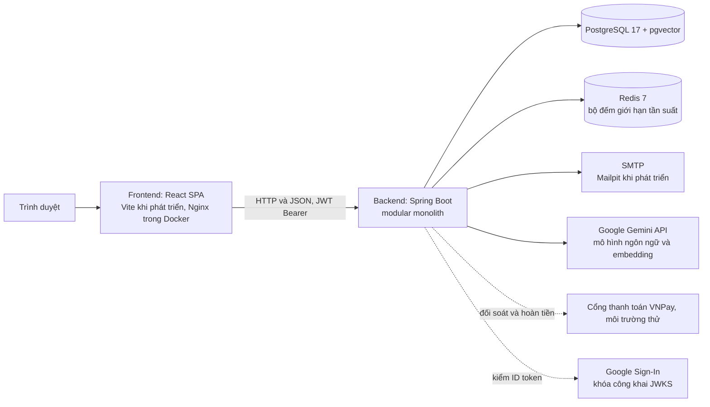

**Hình 3.1. Kiến trúc khối.** Nét đứt: tích hợp phục vụ một số use case; cổng thanh toán mới có phần đối soát và hoàn tiền (tình trạng ngày 25/11/2026, sẽ cập nhật ở T84). *Nguồn: `docs/architecture/system-overview.md` mục 2; ADR-0100, 0109, 0110, 0152.*

Một yêu cầu đi qua các lớp theo thứ tự cố định (Hình 3.2). Controller kiểm hình thức dữ liệu và vai trò, không biết mã quy tắc `BR-…`, không mở transaction, không trả entity. Service mỗi hàm một use case: mở transaction, kiểm phạm vi chi nhánh và quy tắc, gọi bộ xử lý chuyển trạng thái và `api` của module khác, ghi audit và hàng đợi thông báo. Mọi lỗi đi qua `GlobalExceptionHandler` để ra cùng một khuôn phản hồi (mục 3.4).

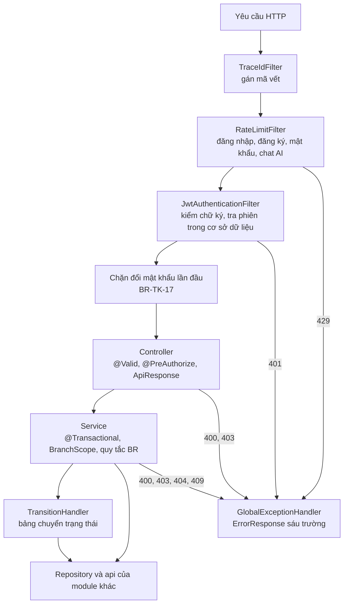

**Hình 3.2. Luồng xử lý một yêu cầu ở backend.** Path công khai bỏ qua token gửi kèm. *Nguồn: `docs/convention/backend/02-layering-and-dto.md`; `docs/architecture/system-overview.md` mục 5; ADR-0005, 0100.*

**Bảng 3.1. Công nghệ chính, lý do chọn và quyết định liên quan**

| Thành phần | Công nghệ | Lý do chọn | ADR |
|---|---|---|---|
| Backend | Java 21, Spring Boot 3.5.15 | một tiến trình, một transaction cho hệ quả liên nhóm | quy ước backend 01 |
| Cơ sở dữ liệu | PostgreSQL 17, Flyway 11.7.2 | khóa dòng, chỉ mục từng phần, ràng buộc `EXCLUDE`; pgvector cho truy hồi của AI | ADR-0109, 0110 |
| Phiên | JWT HS256 (jjwt 0.12.3) gắn bản ghi phiên | hủy phiên có hiệu lực ở yêu cầu kế tiếp; JWT không trạng thái kèm danh sách chặn trên Redis bị loại vì không bảo đảm điều đó khi Redis lỗi | ADR-0003, 0091 |
| Mật khẩu, OTP | BCrypt cost 10 | có sẵn trong Spring Security; Argon2 cần thêm thư viện | ADR-0009 |
| Giới hạn tần suất | Redis 7 | chặn theo IP trước BCrypt; bộ đếm trong bộ nhớ bị loại | ADR-0100 |
| Tài liệu API | springdoc 2.8.11 | tài liệu chạy phải bằng hợp đồng thiết kế | ADR-0040 |

*Nguồn: Bảng S.4 (phiên bản đọc ngày 25/11/2026). Frontend: React 18.3.1, Vite 5.4.21, TypeScript 5.9.3 (mục 3.9). Mô hình ngôn ngữ gọi qua `RestClient` của Spring, không thêm thư viện AI (ADR-0109).*

## 3.2. Module và hợp đồng giữa các module

Đặc tả liệt kê **24 module** (Bảng S.4): 11 nhóm miền, `report` (báo cáo, không có mô hình dữ liệu riêng) và 12 module của giai đoạn 2. Tình trạng ngày 25/11/2026: 19 module có thư mục mã, sẽ cập nhật ở T84.

**Bảng 3.2. Module của hệ thống (kèm phân hệ)**

| Nhóm | Module | Có mã |
|---|---|---|
| Nhóm miền, giai đoạn 1 | identity (TK, QT), branch (CN), customer (KH), catalog (SP), appointment (LH), visit (TN, KB), boarding (LT), sales (BH, TG), inventory (KO), content (CK, BV, DG), care (TB) | cả 11 |
| Báo cáo | report (BC): chỉ ghép số liệu của các module khác | có |
| Giai đoạn 2, có mã | ai (AI), workforce (NS), inpatient (LT nội trú), fees (phí vận chuyển), shop (BH trực tuyến), payment (TG trực tuyến), returns (trả hàng, hoàn tiền) | cả 7 |
| Giai đoạn 2, chưa có mã | materialuse (vật tư tiêu hao), stockops (chuyển kho, kiểm kê), branchlife (tạm ngừng chi nhánh), custmerge (gộp hồ sơ khách), articlex (bài viết của bác sĩ) | chưa |

*Nguồn: `docs/06-module-contracts.md` mục 2; Bảng S.4. "Có mã" chỉ nghĩa là có thư mục mã, chưa nói đủ chức năng (xem Bảng S.2).*

**Quy tắc về gói `api`.** Module khác chỉ được gọi gói `api` của một module (interface, record dữ liệu, enum, sự kiện); không dùng entity, repository hay service nội bộ, và entity chỉ giữ mã số của module khác chứ không ánh xạ quan hệ JPA. Phương thức ghi của `*Api` bắt buộc chạy trong transaction của bên gọi (`MANDATORY`), và lỗi nghiệp vụ do bên sở hữu ném đi thẳng lên use case, vì bắt lỗi thì transaction đã bị đánh dấu hoàn tác. Khi bên sở hữu chưa cài xong, bên đó đưa lớp `*Placeholder` ném `UnsupportedOperationException` chứ không trả giá trị mặc định "an toàn", vì giá trị giả làm điều kiện kiểm tra đi qua sai mà không ai biết (ADR-0113).

Khi một sự kiện lan ra nhiều module, bên phát phát **sự kiện đồng bộ** (Bảng 3.3): bộ nhận chạy cùng luồng và cùng transaction nên lỗi của nó hoàn tác cả use case. Nhóm cấm `@TransactionalEventListener`, `@Async` và `REQUIRES_NEW` trong chuỗi bộ nhận vì chúng phá tính nguyên tử; ngoại lệ duy nhất là nạp chỉ mục tri thức AI (ST22), chạy sau commit vì lời gọi tạo embedding không được nằm trong transaction (ADR-0130).

**Bảng 3.3. Sự kiện đồng bộ (7 sự kiện)**

| Sự kiện | Bên phát | Bên nhận và việc làm |
|---|---|---|
| `PetDeceasedEvent` | customer | appointment, boarding hủy lịch và đặt chỗ đang chờ; visit hủy nhắc tái khám; care hủy Care Task (việc gọi điện nhắc khách) |
| `PetOwnerTransferredEvent` | customer | appointment, boarding hủy lịch đang chờ; care chuyển Care Task sang chủ mới |
| `BranchClinicCancellationEvent` | branch | appointment, boarding hủy lịch và đặt chỗ đang chờ |
| `AccountLockedEvent`, `AccountUnlockedEvent` | identity | visit đánh dấu hoặc gỡ dấu "cần gán lại" của lượt đang khám |
| `StaffLeftBranchEvent` | identity | workforce hủy phân ca chưa bắt đầu |
| `CustomerMergedEvent` | customer | các module giữ mã khách đổi mã; chưa có bên phát (tình trạng ngày 25/11/2026) |

*Nguồn: `docs/06-module-contracts.md` mục 3; Bảng S.4.*

**Đồ thị phụ thuộc.** Đặc tả hợp đồng giữa module không có sơ đồ phụ thuộc mà có hai bảng "ai gọi ai"; Hình 3.3 được vẽ từ hai bảng đó và từ phần interface chéo của giai đoạn 2. Đồ thị **có chu trình** (visit và appointment gọi lẫn nhau, visit và sales cũng vậy); chấp nhận được vì phụ thuộc trỏ vào interface chứ không vào lớp cài đặt, và tính đúng khi chạy dựa vào thứ tự khóa cố định (mục 3.7).

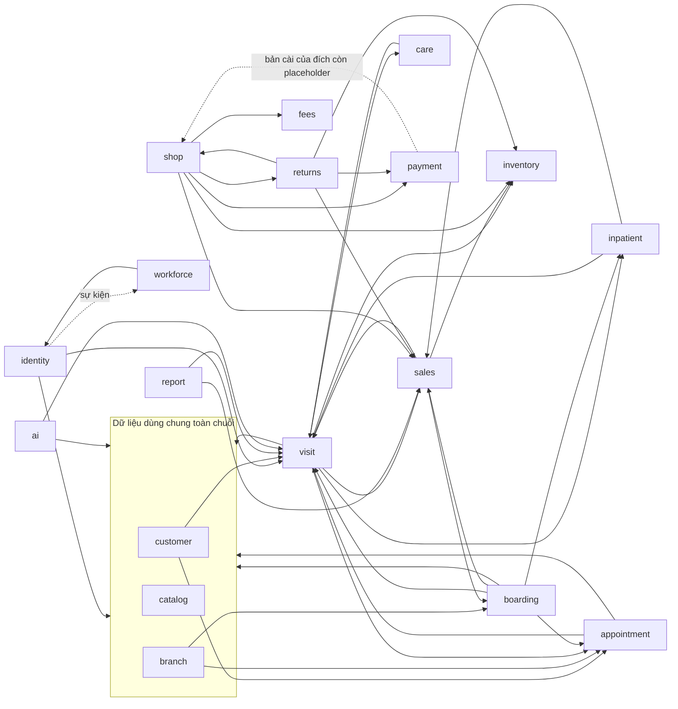

**Hình 3.3. Đồ thị phụ thuộc giữa các module.** Mũi tên A → B: A gọi gói `api` của B; mũi tên tới nhóm "Dữ liệu dùng chung" nghĩa là gọi ít nhất một module trong nhóm. Chỉ vẽ 19 module đã có mã và các quan hệ chính; không vẽ thông báo qua care và audit vì mọi module đều dùng. *Nguồn: `docs/06-module-contracts.md` mục 2, 4, 6b; tình trạng ngày 25/11/2026, sẽ cập nhật ở T84.*

**Hai luồng phải làm đúng thứ tự.** *Ghi nhận mũi tiêm*: khóa thú và lượt khám, khóa Order và sinh dòng vaccine, khóa lô FEFO (xuất lô có hạn dùng gần nhất, chưa hết hạn), rồi mới ghi mũi tiêm và trừ lô; vì mũi tiêm phải trỏ tới cả lô và dòng Order (cột `NOT NULL`) còn lịch sử tồn kho cần mã mũi tiêm, nên chứng từ khóa trước, lô khóa sau. *Thu tiền* và hoàn tất lượt khám vẽ ở Hình 3.7 và 3.6.

**Interface chéo của giai đoạn 2**: `shop` giữ, nhả, trừ và nhập lại hàng qua `StockApi`; `returns` trả hàng về lô gốc và hoàn tiền qua `PaymentGatewayClient`; `inpatient` tạo lượt điều trị qua `VisitApi`, còn `boarding` và `visit` hỏi `AdmissionQueryApi` để không kết thúc lưu trú hay hoàn tất lượt khi còn ca nội trú. Tình trạng ngày 25/11/2026: vài placeholder còn lại, như `OnlineOrderApi` mà `payment` sẽ gọi.

## 3.3. Thiết kế cơ sở dữ liệu

Schema có **88 bảng** (Bảng S.1): qua các migration, 90 bảng được tạo và 2 bảng khiếu nại bị xóa ở V51 (ADR-0122 về bỏ khiếu nại). Hai bảng còn nhưng không có mã dùng: `surgeries` (phẫu thuật bị bỏ, ADR-0125) và `branch_home_visit_fees` (khám tại nhà bị bỏ, ADR-0124 về bỏ khám tại nhà); vậy 86 bảng đang dùng. Tài liệu thiết kế bảng chính có 59 mục bảng, phần còn lại nằm ở đặc tả từng phân hệ.

**Bảng 3.4. Quy ước thiết kế bảng**

| Hạng mục | Quy ước |
|---|---|
| Khóa, tên | khóa chính `BIGINT` tự tăng; bảng `snake_case` số nhiều; khóa ngoại `<bảng số ít>_id`; mọi khóa ngoại `RESTRICT`, không `CASCADE` |
| Loại bảng | ROOT, PART, REF có `created_at`, `updated_at`; LOG chỉ có `created_at`, chỉ được thêm |
| Thời gian, tiền | `TIMESTAMPTZ` theo UTC, lấy từ một bean đồng hồ duy nhất (ADR-0015); tiền `BIGINT` đơn vị đồng, tránh sai số số thực |
| Trạng thái, mã | `VARCHAR(30)` cộng `CHECK` danh sách giá trị, mã ASCII; mã chứng từ sinh bằng bảng đếm khóa dòng nên dãy liên tục (ADR-0043) |

*Nguồn: `docs/05-erd.md` mục 0, 13; ADR-0015, 0043.*

Các ràng buộc dưới đây là lưới an toàn cuối cùng: service kiểm trước để trả đúng mã quy tắc, ràng buộc chỉ bắt hai yêu cầu chạy song song.

**Bảng 3.5. Ràng buộc ở mức cơ sở dữ liệu**

| Nhóm | Ví dụ | Quy tắc |
|---|---|---|
| Duy nhất từng phần | một thú một lịch hẹn chờ mỗi khung giờ; một lễ tân một ca thu ngân đang mở; một chuồng một thú | BR-LH-05, BR-TG-05, BR-LT-08 |
| Chống chồng ngày | `EXCLUDE USING gist` cấm hai đặt chỗ lưu trú của một thú chồng ngày | BR-LT-02 |
| Đúng một nguồn | Order thuộc đúng một trong lượt khám, lưu trú, bán lẻ | BR-BH-01 |
| Toàn vẹn tồn kho | số dư lô không âm; mỗi sản phẩm không quản lý hạn có một lô mặc định | BR-KO-01 |
| Audit | không có khóa ngoại tới tài khoản; trigger chặn sửa đã gỡ ở V31, "chỉ thêm" nay giữ ở tầng ứng dụng | ADR-0098 |

*Nguồn: `docs/05-erd.md` các mục bảng và mục 13.*

**Migration.** Schema do Flyway (công cụ áp các tệp SQL đánh số theo thứ tự) sở hữu, ứng dụng chạy với `ddl-auto=validate` nên entity phải khớp bảng. Có **64 tệp migration**, V1 đến V64 và V66 (V66 viết ngày 27/11/2026, chưa áp lên DB demo). V49 để trống có chủ đích: cơ sở dữ liệu đã áp V50 sẽ không khởi động nếu V49 xuất hiện sau (ADR-0114). Migration đã áp không được sửa (Flyway kiểm checksum) và không có bản lùi; muốn đổi thì thêm migration mới (số kế tiếp V67; V65 sẽ bỏ trống mãi vì trigger khóa bệnh án, viết với số V65, sẽ vào cây mã với số V67 do V66 đã đi trước).

Sáu hình dưới là ER rút gọn theo nhóm nghiệp vụ, chỉ vẽ bảng chính với khóa chính (PK), khóa ngoại (FK), khóa duy nhất (UK) và vài cột đặc trưng; các bảng còn lại, `document_counters` và hai bảng không dùng nằm ở phụ lục mô tả từng bảng.

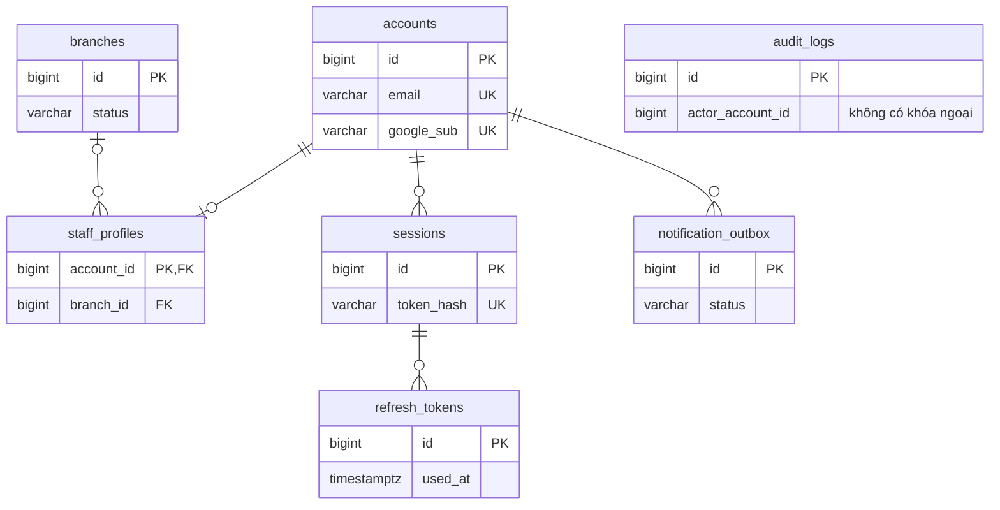

**Hình 3.4a. ER rút gọn: định danh, thông báo, chi nhánh.** *Nguồn: `docs/05-erd.md` mục 1, 2, 11; migration V27, V64.*

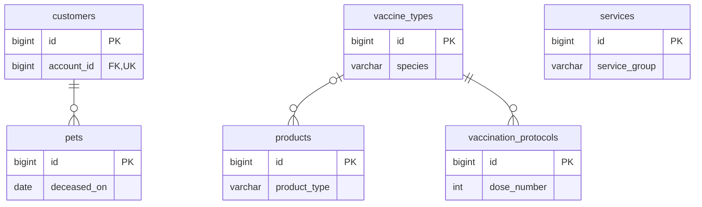

**Hình 3.4b. ER rút gọn: khách hàng, thú cưng, danh mục.** *Nguồn: `docs/05-erd.md` mục 3, 4.*

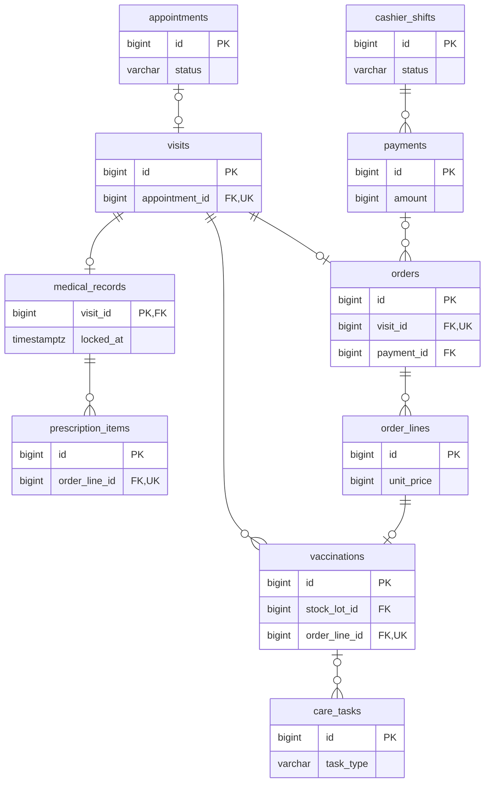

**Hình 3.4c. ER rút gọn: lịch hẹn, khám, bán hàng, thu ngân.** *Nguồn: `docs/05-erd.md` mục 5, 6, 8, 11.*

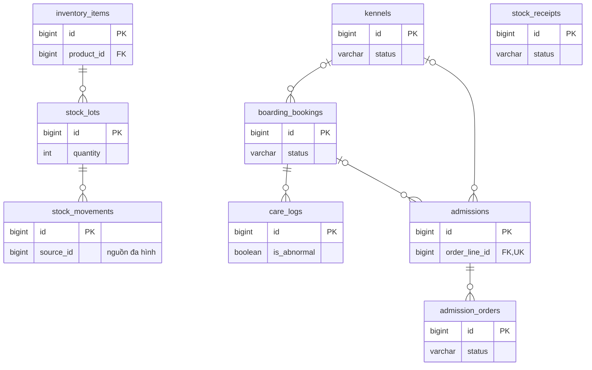

**Hình 3.4d. ER rút gọn: kho, lưu trú, nội trú.** *Nguồn: `docs/05-erd.md` mục 7, 9; `docs/09` mục C.*

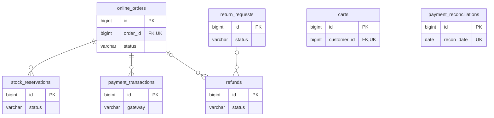

**Hình 3.4e. ER rút gọn: đơn online, thanh toán, trả hàng.** *Nguồn: `docs/08-tang3-be2-spec.md` mục B, C, D.*

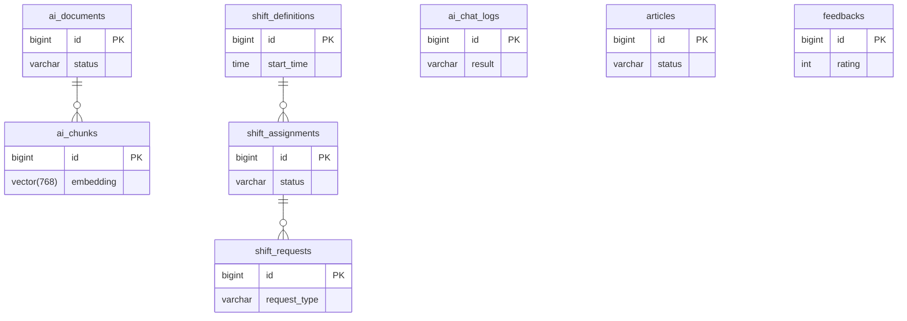

**Hình 3.4f. ER rút gọn: AI, nhân sự, nội dung.** Bảng nhật ký hỏi đáp của AI cố ý không có cột tài khoản hay địa chỉ IP. *Nguồn: `docs/07-ai-subsystem.md` mục 8; `docs/05-erd.md` mục 10, 14; ADR-0141.*

## 3.4. Thiết kế API

Hợp đồng giữa frontend và backend được thiết kế **từ nghiệp vụ, không từ bảng**: use case, quy tắc, chuyển trạng thái, mô hình, bảng, rồi mới tới thao tác (một cặp phương thức và đường dẫn). Mỗi thao tác có một use case đứng sau; mỗi chuyển trạng thái do người kích hoạt có đúng một thao tác `POST /<tài nguyên>/{id}/<hành động>`, không đổi trạng thái bằng `PATCH`; chuyển do hệ thống thực hiện không có thao tác; thiếu thông tin thì chọn phương án ít phát minh nhất và ghi giả định.

Mỗi module có một khai báo duy nhất, từ đó sinh cả bản đọc cho người lẫn bản OpenAPI cho máy. Hợp đồng có **24 tệp, 347 thao tác**: 232 của giai đoạn 1 (12 module) và 115 của giai đoạn 2 (12 module), số theo module ở Bảng S.2. Tài liệu Swagger của backend sinh từ annotation, và bài kiểm tra `OpenApiContractParityIT` buộc nó **bằng** hợp đồng: sửa một bên mà quên bên kia thì test đỏ (ADR-0040). Tình trạng ngày 25/11/2026: 297 handler khớp từng cặp (phương thức, đường dẫn) với 297 trong 347 thao tác, không handler nào ngoài hợp đồng; đây mới là kiểm tra có handler, chưa đo hành vi.

**Khuôn phản hồi.** Thành công: `{ "data": …, "message": "success", "code": 200 }`; danh sách phân trang trả `data` gồm `content`, `page`, `size`, `totalElements`, `totalPages`, với `page` từ 0, `size` mặc định 20 và tối đa 100. Mọi lỗi dùng một khuôn sáu trường do `GlobalExceptionHandler` tạo:

```json
{ "success": false, "errorCode": "BUSINESS_RULE_VIOLATION", "message": "… (BR-LH-05)",
  "statusCode": 400, "timestamp": "…", "traceId": "…" }
```

Lỗi quy tắc có `message` tiếng Việt kết thúc bằng mã quy tắc, để frontend phân biệt quy tắc thì đọc mã ở cuối. Hệ thống không dùng 422; quy tắc mà giao diện cần phân biệt (chưa xác thực, khóa tạm, phải đổi mật khẩu) trả 400 chứ không 403, vì 403 chỉ mang thông điệp chung.

**Bảng 3.6. Mã lỗi**

| HTTP | `errorCode` | Khi nào |
|---|---|---|
| 400 | `VALIDATION_FAILED`, `MALFORMED_REQUEST` | sai định dạng, thiếu trường, sai kiểu |
| 400 | `BUSINESS_RULE_VIOLATION` | vi phạm quy tắc; `message` kết thúc `(BR-…)` |
| 401 | `UNAUTHENTICATED` | chưa đăng nhập, token sai hoặc hết hạn, phiên bị hủy |
| 403 | `ACCESS_DENIED`, `ACCESS_DENIED_SCOPE_MISMATCH` | sai vai trò; ngoài phạm vi (chi nhánh khác, không phải chủ dữ liệu) |
| 404 | `RESOURCE_NOT_FOUND` | không có, hoặc người gọi không được biết là có |
| 409 | `INVALID_STATE_TRANSITION`, `CONCURRENCY_CONFLICT` | không có cạnh chuyển trạng thái; tranh chấp đồng thời, bế tắc |
| 429 | `TOO_MANY_REQUESTS` | một IP gọi quá nhiều; kèm `Retry-After` (ADR-0100) |
| 503 | `SERVICE_UNAVAILABLE` | dịch vụ ngoài tạm không dùng được; hiện chỉ đăng nhập Google (ADR-0152) |

*Nguồn: `docs/api/00-method.md` mục 3.5; `docs/convention/backend/04-exception-handling.md`.*

**Thứ tự kiểm lỗi.** Quy tắc chung của hợp đồng: quyền, tồn tại (404), phạm vi chi nhánh (403), guard nghiệp vụ (400), rồi chuyển trạng thái hợp lệ (409). Ngoại lệ ghi bằng ADR, nơi 409 đứng trước 400: nhân sự (ADR-0148 về nhân sự), nội trú (ADR-0149 về nội trú) và xử lý đơn online (ADR-0146). Nền tảng còn chạy Bean Validation trước kiểm vai trò nên thân sai nhận 400 dù người gọi thiếu quyền (ADR-0149 về nhân sự, mục 15).

**Phân quyền.** Bảy vai trò chia ba phạm vi dữ liệu (ADR-0006, Bảng 3.7). Vai trò kiểm bằng `@PreAuthorize` ở controller, phạm vi chi nhánh do service gọi `BranchScope`; `branchId` truyền vào chỉ có tác dụng với `CHAIN`. Khách không đi qua `BranchScope`: gọi vào đó luôn 403, nên nhánh mã quên lọc theo chủ dữ liệu thì khách nhận 403 chứ không nhận dữ liệu cả chuỗi.

**Bảng 3.7. Vai trò và phạm vi dữ liệu**

| Vai trò (tác nhân) | Phạm vi | Quy tắc |
|---|---|---|
| CUSTOMER (A02) | `OWNER` | chỉ dữ liệu của mình; của người khác trả 404 |
| ADMIN (A03), SUPER_MANAGER (A04) | `CHAIN` | toàn chuỗi; truyền `branchId` để lọc |
| BRANCH_MANAGER (A05), RECEPTIONIST (A06), VET (A07), CARETAKER (A08) | `BRANCH` | chi nhánh của mình; chi nhánh khác trả 403 |

*Nguồn: `docs/api/00-method.md` mục 3.3; ADR-0003, 0006; Bảng 2.1.*

## 3.5. Máy trạng thái và sự kiện miền

Chương 2 (mục 2.7) trình bày 23 máy trạng thái hiệu lực (Bảng 2.6) và vẽ năm máy tiêu biểu (Hình 2.2 đến 2.6); mục này nói cách cài đặt chung. Mỗi đối tượng có vòng đời có một lớp `{Đối tượng}TransitionHandler` kế thừa `StateMachineBase`, khai báo `allowedTransitions()` (bảng cạnh chép **đúng** từ bảng đánh số của đặc tả) và `initialStates()`; cạnh không có trong bảng bị từ chối bằng `InvalidStateTransitionException` (409). Tình trạng ngày 25/11/2026: mã có 16 lớp như vậy (Bảng S.4), chưa đối chiếu từng đối tượng (`TODO(T84)`).

Bộ xử lý chỉ giữ bảng cạnh; điều kiện nghiệp vụ (guard) nằm ở service và ném lỗi 400, hệ quả sang đối tượng khác do service điều phối. Ba trường hợp đặc biệt: Tài khoản có hai chiều độc lập (trạng thái trong bảng, khóa tài khoản là cờ riêng); Order có trạng thái khởi tạo tùy nguồn nên `initialStates()` có hai giá trị; cạnh do hệ thống kích hoạt được phát từ service khác trong cùng transaction hoặc từ tác vụ nền (mục 3.8).

Bảng cạnh được kiểm bằng lớp test dùng chung `FsmTransitionTestBase`: mỗi máy khai báo **bản sao độc lập** của bảng đặc tả (không đọc lại từ bộ xử lý, nếu không test chỉ xác nhận chính nó), và lớp cơ sở sinh một ca cho mọi cặp `từ × tới` cùng mọi trạng thái khởi tạo; thừa hoặc thiếu một cạnh đều làm test đỏ. Các cạnh vượt ranh giới module dùng sự kiện ở Bảng 3.3; thứ tự bộ nhận được cố định bằng `@Order` (visit trước care) vì hai bảng phải khóa theo thứ tự `medical_records` rồi `care_tasks`.

## 3.6. Bảo mật

**Xác thực.** Đăng nhập trả hai token. *Access token* là JWT (JSON Web Token, token có chữ ký số) ký HS256 chỉ chứa ba định danh (tài khoản, phiên, mã ngẫu nhiên của token), không chứa vai trò hay chi nhánh. Mỗi yêu cầu chạy một truy vấn kiểm phiên và đọc vai trò, chi nhánh từ cơ sở dữ liệu, nên đổi chức vụ, điều chuyển, khóa hay vô hiệu hóa có hiệu lực ở yêu cầu kế tiếp mà không phải hủy phiên (ADR-0003). Access token sống **10 phút** (tham số cấu hình, khoảng 5 đến 720) và chỉ được gia hạn khi người dùng còn thao tác; hạn tuyệt đối của phiên là **12 giờ** (khoảng 1 đến 72), chốt vào bản ghi lúc tạo (ADR-0091, 0003). *Refresh token* là chuỗi ngẫu nhiên 256 bit, chỉ lưu giá trị băm, **xoay vòng**: mỗi lần làm mới, token cũ bị đánh dấu đã dùng; dùng lại token đã dùng bị coi là dấu hiệu lộ nên phiên bị hủy và ghi audit (Hình 3.5).

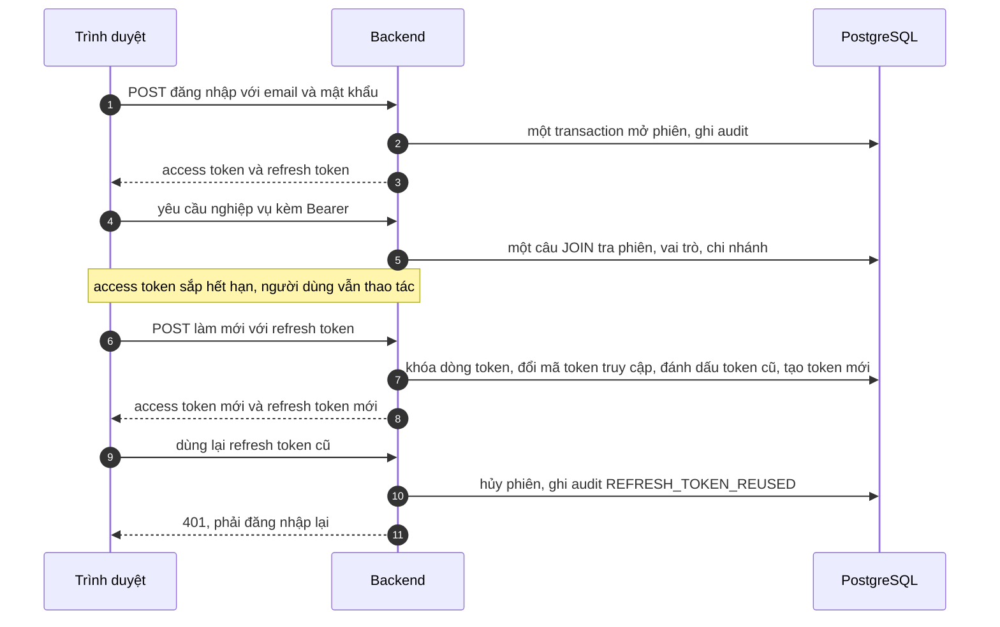

**Hình 3.5. Đăng nhập và làm mới token xoay vòng.** *Nguồn: ADR-0003, 0091; `docs/api/00-method.md` mục 3.1.*

Mật khẩu và mã OTP được băm bằng BCrypt (hàm băm có muối, cố ý chậm; cost 10) ngoài transaction để không giữ kết nối; mật khẩu quá 72 byte bị từ chối thay vì cắt ngầm (ADR-0009). Chống dò có hai lớp: khóa tạm tài khoản sau nhiều lần sai liên tiếp (BR-TK-09, ADR-0019) và giới hạn theo IP trước cả BCrypt, cửa sổ cố định 60 giây trên Redis với đăng nhập 30, đăng ký 10, mật khẩu 10; Redis lỗi thì cho qua (ADR-0100, còn Proposed). Chat AI có hai cửa sổ riêng, 10 mỗi phút và 60 mỗi giờ (ADR-0110). Audit do `AuditRecorder` ghi tường minh trong transaction nghiệp vụ, riêng sự kiện thất bại ghi ở transaction riêng, và cấm khóa nhạy cảm; bảng audit chỉ thêm ở tầng ứng dụng (ADR-0001, 0098).

**Đăng nhập bằng Google** (ADR-0152, còn Proposed; kiểm tay chưa có kết quả). Rủi ro chính là kẻ đăng ký trước bằng email của nạn nhân rồi chờ nạn nhân đăng nhập Google. Thiết kế đáp lại bằng ba quyết định: tra theo mã `sub` ổn định của Google chứ không theo email; chỉ tự gắn hoặc thay tài khoản khi Google bảo chứng email (Gmail hoặc Google Workspace); xóa hẳn tài khoản chờ xác thực rồi tạo mới thay vì kích hoạt tại chỗ. Lời gọi tới Google nằm ngoài transaction; không lấy được khóa công khai thì trả 503, đăng nhập bằng mật khẩu vẫn dùng được.

**CORS và CSRF.** Token nằm ở tiêu đề `Authorization`, không dùng cookie: CORS (cho trang web gọi API khác nguồn) không cho gửi thông tin xác thực và biện pháp chống CSRF (giả mạo yêu cầu từ trang khác) tắt, vì cookie `httpOnly` kéo theo thiết kế lại cả hai; đánh đổi đã ghi là refresh token bị lộ dùng được tới hết hạn phiên nếu kẻ trộm dùng trước (ADR-0091). Dữ liệu chỉ nhân viên được xem có DTO riêng cho khách; 403 mang thông điệp chung và 404 thay 403 khi người gọi không được biết bản ghi tồn tại. Quyền riêng tư của AI ở chương 6.

## 3.7. Đồng thời và khóa

**Nguyên tắc.** Mỗi use case ghi là **một transaction** ở service, bao trọn kiểm tra, đổi trạng thái, hệ quả, audit và hàng đợi thông báo; không bắt lỗi bên trong. Việc cần chạy ngoài transaction (băm mật khẩu, gọi dịch vụ ngoài, ghi audit sau hoàn tác) tách vào lớp mặt tiền không có transaction. Thứ tự trong use case: kiểm quyền, khóa, đọc dưới khóa (đọc trước khóa thì ngữ cảnh lưu trữ trả bản cũ), lấy giờ, kiểm guard, ghi, ghi audit và hàng đợi.

Khóa chủ yếu là khóa dòng bi quan `FOR NO KEY UPDATE`. Kiểm tra khóa ngoại chỉ lấy `FOR KEY SHARE`, không xung đột với khóa này, nên module chèn dòng trỏ tới thú hay nhân viên phải khóa dòng đó bằng `FOR SHARE` tường minh trước. Với phép đếm không có dòng nào để khóa (hạn mức khung giờ, số lịch hẹn của một thú) hệ thống dùng khóa tư vấn (advisory lock) của PostgreSQL theo vùng: 1001 (thú, ghi lịch hẹn), 1002 (khách, đánh giá vi phạm, luôn lấy cuối), 1003 (khách, gửi feedback), 1004 (thú, ghi hoặc xóa mũi tiêm); số tự do kế tiếp là 1005 (Bảng S.4). Mức cô lập mặc định là READ COMMITTED; đọc phân trang dùng `readOnly` cùng REPEATABLE READ để đếm và lấy trang thấy cùng một ảnh chụp, còn luồng ghi đọc lại sau khi chờ khóa phải giữ READ COMMITTED. Bế tắc bị cơ sở dữ liệu hủy một bên và trả 409.

Mọi luồng trong cùng vùng lấy khóa theo cùng thứ tự (Bảng 3.8) nên không có chu trình chờ; nhiều dòng cùng loại (lô, Order) được khóa trong **một câu** theo mã tăng dần.

**Bảng 3.8. Thứ tự khóa theo vùng** (rút gọn)

| Vùng | Thứ tự khóa | ADR |
|---|---|---|
| Phiên | `accounts` → `sessions`; làm mới: `refresh_tokens` → `sessions`, không bao giờ `accounts` | 0091 |
| Lịch hẹn | khóa 1001 (thú) → `branches` → `appointments`; 1002 (khách) luôn cuối | 0045 |
| Thu tiền | ca thu ngân → mọi Order một câu → mọi lô một câu → bộ đếm mã chứng từ cuối | 0064 |
| Đơn online | `carts` → `branches` (đọc) → `products` → mọi lô một câu; ghi lên đơn: `online_orders` → `orders` → `payment_transactions` → `stock_reservations` → `stock_lots` | 0144, 0145 |
| Nhân sự | `accounts` → `shift_definitions` (chia sẻ) → `shift_assignments` → `shift_requests` | 0148, 0149 (nhân sự) |
| Nội trú | `pets` (chia sẻ) → `visits` hoặc `boarding_bookings` (chia sẻ) → `kennels` → bộ đếm mã → `admissions` | 0149 (nội trú) |

*Nguồn: `docs/architecture/concurrency-locking.md`; các ADR ở cột cuối.*

Hình 3.6 minh họa hoàn tất lượt khám. Bước kiểm điều kiện theo loại dịch vụ (BR-KB-02) chạy **sau** các lệnh ghi, vì chỉ đọc đúng dịch vụ của lượt sau khi đã khóa Order; cách này an toàn nhờ không bắt lỗi trong transaction và các phương thức được gọi đều `MANDATORY`, nên lỗi bất kỳ hoàn tác cả bốn bảng (ADR-0069).

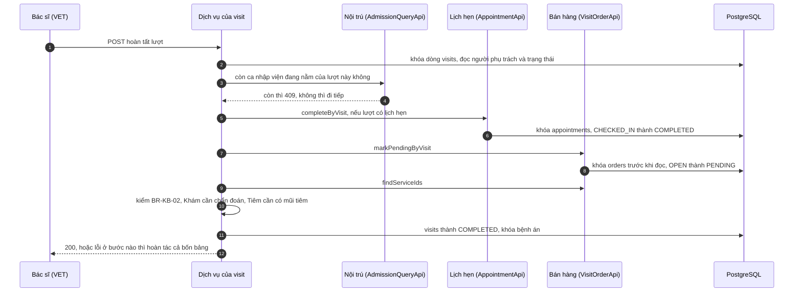

**Hình 3.6. Chuỗi hoàn tất lượt khám (Visit #5).** *Nguồn: `docs/06-module-contracts.md` mục 4.1; ADR-0069; ADR-0149 (nội trú) mục 21.*

Hình 3.7 minh họa thu tiền. Ca thu ngân được khóa chia sẻ nên nhiều lần thu cùng ca chạy song song, còn chốt ca phải chờ chúng xong. Khóa mọi lô của mọi sản phẩm trong **một** câu là bắt buộc, vì khóa từng sản phẩm thì hai quầy thu gộp chéo sản phẩm sẽ bế tắc; mã phiếu thu sinh sau cùng để bảng đếm bị giữ ngắn nhất (ADR-0064).

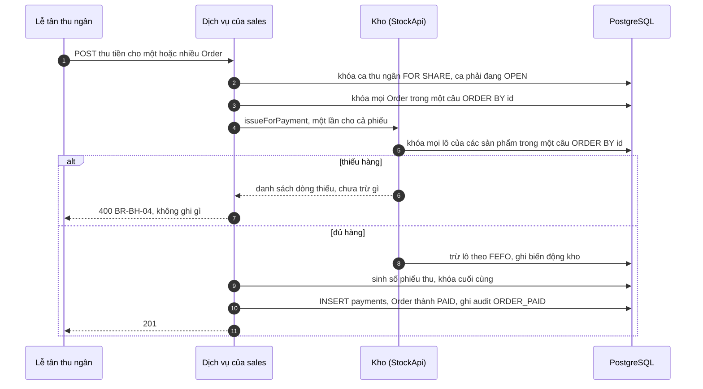

**Hình 3.7. Chuỗi thu tiền Order (Order #8).** *Nguồn: `docs/06-module-contracts.md` mục 5; `docs/architecture/concurrency-locking.md`; ADR-0064.*

## 3.8. Tác vụ nền và thông báo

**Hàng đợi thông báo (outbox).** Module cần gửi thông báo ghi một dòng vào bảng hàng đợi qua `NotificationApi.enqueue` trong cùng transaction với sự kiện nghiệp vụ, nên nghiệp vụ hoàn tác thì không có thông báo nào gửi nhầm. Tác vụ ST20 gửi sau theo hai luồng: ưu tiên cho thông báo có người đang chờ (mã OTP, mật khẩu tạm) để chúng không xếp sau hàng trăm thư nhắc, và thường cho phần còn lại. Mỗi thư xử lý trong một transaction. Thất bại tạm thời thì thử lại sau 1, 2, 4, 8 phút, lần thất bại thứ 5 thì `FAILED`; lỗi vĩnh viễn `FAILED` ngay; mã OTP và mật khẩu bị xóa khỏi nội dung dòng sau khi xử lý (ADR-0012).

**Tác vụ định kỳ.** Mã có 26 lớp `*Job` và 28 annotation `@Scheduled`; chênh lệch chưa đối chiếu từng lớp (`TODO(T84)`). Tình trạng ngày 25/11/2026: đủ 12 trong 12 tác vụ của giai đoạn 1 và 8 trong 10 của giai đoạn 2, chưa có ST07 và ST11 (Bảng S.2). Cơ chế là `@Scheduled` của Spring trên **một instance** với bộ lập lịch 4 luồng (ADR-0007 ghi một luồng, sau tăng lên 4: ADR-0114). Khóa phân tán (ShedLock), Quartz và tác vụ ngoài gọi endpoint bị loại vì thêm phụ thuộc hay bề mặt tấn công cho vấn đề chưa có với một instance; đổi lại job phải **idempotent** (chạy lại không làm sai dữ liệu) và cần ADR mới trước khi chạy nhiều instance.

Mọi job theo một khuôn: nằm trong module sở hữu dữ liệu, lịch đặt bằng tham số theo giờ Việt Nam, bản thân job không có transaction. Job duyệt trước danh sách mã, rồi xử lý **mỗi bản ghi trong một transaction**: khóa dòng bằng `FOR NO KEY UPDATE SKIP LOCKED` (bỏ qua bản ghi đang bị use case khác giữ), kiểm lại điều kiện dưới khóa, ghi bằng câu cập nhật có điều kiện trạng thái, rồi ghi hàng đợi. Bản ghi lỗi chỉ hoàn tác chính nó và được xử lý bù ở lượt sau; mỗi lượt có ngân sách thời gian.

**Job dọn dữ liệu kỹ thuật.** Phiên, OTP, refresh token và thông báo là dữ liệu kỹ thuật, không phải dữ liệu nghiệp vụ, nên được xóa cứng khi hết ích lợi (ngoại lệ của nguyên tắc 2 mô hình miền, ghi trong chính các ADR); hạn giữ không ngắn hơn cửa sổ mà chức năng khác còn cần.

**Bảng 3.9. Job dọn dữ liệu kỹ thuật**

| Dữ liệu | Giờ chạy hằng ngày | Điều kiện xóa | ADR |
|---|---|---|---|
| Phiên đăng nhập | 03:00 | quá 30 ngày kể từ lúc hết hạn | 0008 |
| Refresh token | 03:10:11 | quá 1 ngày kể từ lúc hết hạn (ADR còn Proposed) | 0114 |
| Mã OTP | 03:20:17 | quá 1 ngày kể từ lúc hết hạn | 0111 |
| Thông báo trong ứng dụng | 03:50:23 | đã đọc quá 30 ngày; chưa đọc quá 90 ngày | 0112 |

*Nguồn: các ADR ở cột cuối; Bảng S.4. Số ngày giữ của ba dòng đầu chưa có trong Bảng S.4 (`TODO(T84)`).*

## 3.9. Thiết kế giao diện

Giao diện là ứng dụng một trang chia **bốn khu** theo đối tượng dùng: khu công khai (giới thiệu, dịch vụ, sản phẩm, chi nhánh, tin tức, đăng nhập, chat AI), khu khách hàng (hồ sơ, thú cưng, đặt lịch, lưu trú, đơn online), bàn làm việc của nhân viên vận hành (tiếp nhận, phòng khám, thu tiền, lưu trú) và khu quản trị (chi nhánh, danh mục, kho, nhân sự, báo cáo, AI, cấu hình). Mọi vai trò dùng chung một phiên; lớp chặn route chuyển người chưa đăng nhập tới trang đăng nhập, người còn cờ phải đổi mật khẩu tới trang đổi, và hiện 403 tại chỗ khi sai vai trò; một số trang của khách còn nằm sau lớp chặn "chờ quyết định liên kết hồ sơ" (BR-TK-19). Quyền vào route của khu quản trị suy ra từ menu gắn tập vai trò, nên thêm mục menu chính là thêm quyền.

Kiến trúc frontend (Hình 3.8) tách ba mối quan tâm. **Dữ liệu từ máy chủ** do React Query quản lý, có bộ nhớ đệm theo khóa; lỗi 4xx không thử lại. **Trạng thái phía khách** (phiên, tài khoản hiện tại) do Zustand giữ. **Lớp HTTP** là một client Axios duy nhất: gắn token, chuyển lỗi sang `ApiError` (sáu trường của khuôn lỗi cộng mã quy tắc cắt từ cuối thông điệp) và làm mới token, chỉ khi người dùng có thao tác và token sắp hết hạn; các lần thăm dò tự động không làm mới, nếu không nhân viên bỏ máy vẫn "trực tuyến" mãi (ADR-0091).

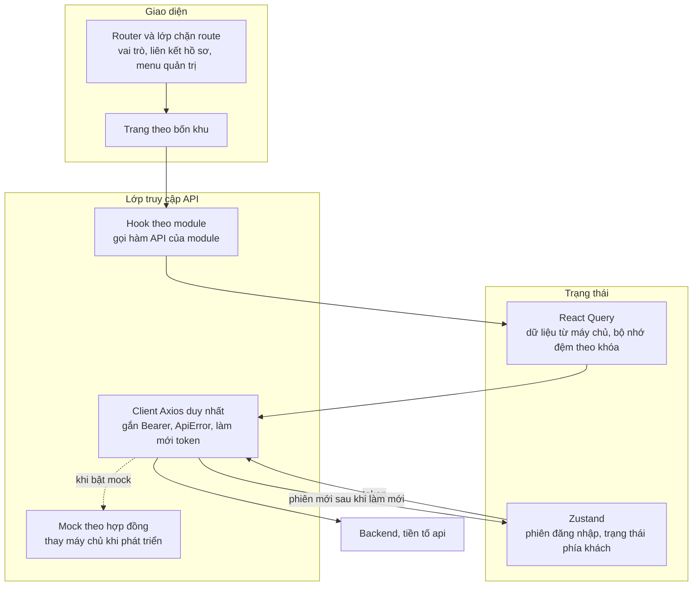

**Hình 3.8. Kiến trúc frontend.** *Nguồn: `docs/architecture/frontend-notes.md`; `docs/architecture/system-overview.md` mục 6; ADR-0091.*

**Dữ liệu mô phỏng theo hợp đồng.** Frontend dựng song song với backend nên có lớp mock thay máy chủ, trả lời `METHOD /api/<đường dẫn>` đúng khuôn của hợp đồng; mock bật khi phát triển, tắt trong bản dựng. Quy tắc rút ra khi chạy với backend thật: **mock không được dễ dãi hơn backend**, vì mock dễ dãi che lỗi cho tới khi chạy thật; ví dụ mock trả chi nhánh trong phản hồi đăng nhập còn backend thật thì không. Vì vậy mock mới phải được viết sau khi đọc controller và DTO của backend. Tình trạng ngày 25/11/2026, sẽ cập nhật ở T84: thứ tự kiểm lỗi của mock giai đoạn 2 mới được đo trên backend thật ở một số module và chưa thống nhất giữa các mock.

## 3.10. Kết luận chương

Thiết kế dựa trên ba lựa chọn. Thứ nhất, backend là modular monolith để hệ quả liên nhóm nghiệp vụ chạy trong một transaction; ranh giới module giữ bằng gói `api` công bố, còn phối hợp một-nhiều dùng sự kiện đồng bộ cùng transaction. Thứ hai, tính đúng của dữ liệu được bảo đảm hai lớp: service kiểm quy tắc để trả đúng mã lỗi, cơ sở dữ liệu giữ ràng buộc để chặn hai yêu cầu song song; thứ tự khóa từng vùng được cố định để không có chu trình chờ. Thứ ba, hợp đồng API là nguồn chân lý giữa hai ứng dụng: sinh từ một khai báo, kiểm bằng công cụ, và buộc tài liệu của backend phải bằng nó.

Các thành phần còn lại bám theo ba lựa chọn đó: bộ xử lý chuyển trạng thái chép đúng bảng đặc tả; xác thực bằng token ngắn hạn gắn bản ghi phiên để thu hồi tức thì; tác vụ nền xử lý từng bản ghi trong một transaction; giao diện chia bốn khu và dùng một lớp HTTP. Các nhận định về tình trạng cài đặt là số tạm ngày 25/11/2026, sẽ đo lại ở T84. Chương 4 trình bày cài đặt, chương 5 kiểm thử, chương 6 phân hệ trí tuệ nhân tạo.

## Nguồn

`docs/architecture/{system-overview,concurrency-locking,frontend-notes}.md`; `docs/04-domain-model.md`; `docs/05-erd.md`; `docs/06-module-contracts.md`; `docs/07-ai-subsystem.md` (mục 8); `docs/08-tang3-be2-spec.md`; `docs/09-tang3-be1-spec.md`; `docs/api/00-method.md`; `docs/convention/backend/01` đến `10`; `docs/time.md`; `docs/bao-cao/00-so-lieu.md` (Bảng S.1, S.2, S.4); mã nguồn `BE/src/main/resources/db/migration/` (V27, V34 đến V48) và `BE/src/main/java/com/petcare/module/*/api/`.

ADR: 0001, 0003, 0005, 0006, 0007, 0008, 0009, 0012, 0015, 0019, 0040, 0043, 0045, 0064, 0069, 0091, 0098, 0100, 0109, 0110, 0111, 0112, 0113, 0114, 0125, 0130, 0141, 0144, 0145, 0146, 0152; ADR số trùng: 0122 (tệp `0122-drop-complaint-feedback-stateless-retention`), 0124 (tệp `0124-bo-kham-tai-nha`), 0148 (tệp `0148-workforce-contract-error-order-staff-reads`), 0149 (tệp `0149-inpatient-foundation-entities-fsm` và tệp `0149-workforce-foundation-entities-fsm`). ADR-0019 và 0045 dẫn qua `docs/06` và `docs/architecture/concurrency-locking.md`, chưa mở trực tiếp.

## TODO

- `TODO(T84)`: cập nhật Bảng 3.2 và các câu "tình trạng ngày 25/11/2026" sau T83; đối chiếu 23 máy trạng thái với 16 lớp bộ xử lý và 26 lớp `*Job` với 28 annotation `@Scheduled`.
- `TODO(T84)`: bổ sung vào `00-so-lieu.md` số ngày giữ của Bảng 3.9 (30, 1, 1) nếu giữ trong thân bài; chạy trình phân tích Mermaid 11 cho 13 khối của chương và mở xem hình thật.
- Việc T86-7: phụ lục mô tả từng bảng của 88 bảng; xuất sơ đồ sang ảnh cho docx; chờ mẫu của khoa.
- Việc chương khác: số tệp test (chương 5); phân hệ AI (chương 6).
