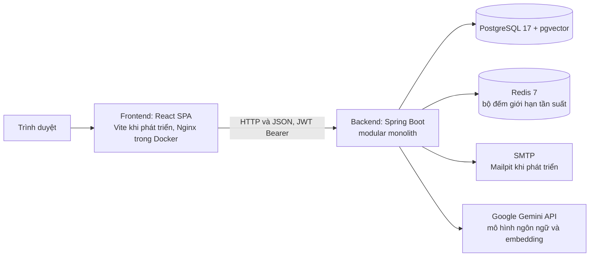

# Chương 3. Thiết kế hệ thống

> Trạng thái: **khung** (T86-1, 18/11/2026). Nội dung viết ở phiên T86-2; chỉ phụ thuộc đặc tả nên làm được ngay. Mục 3.1 đã có một hình dựng sẵn.

## 3.1. Kiến trúc tổng thể

*Sẽ viết:* hai ứng dụng triển khai độc lập (backend REST, frontend SPA) giao tiếp bằng HTTP và JSON, xác thực bằng JWT Bearer; backend là modular monolith theo DDD gồm tầng `platform` dùng chung (cấu hình, bảo mật, xử lý ngoại lệ, lớp cơ sở FSM, định dạng phản hồi, ghi audit) và các module nghiệp vụ; luồng xử lý một request (lọc trace-id, Spring Security, controller, service, bộ xử lý FSM, repository); môi trường chạy (phát triển, Docker, kiểm thử).

**Hình 3.1. Kiến trúc khối.** *Nguồn: `docs/architecture/system-overview.md` mục 2; ADR-0100, ADR-0109, ADR-0110. Cổng thanh toán (S02) thuộc giai đoạn 2 và chưa cài tại ngày viết nên chưa vẽ.*

## 3.2. Module và hợp đồng giữa các module

*Sẽ viết:* bảng module và chủ sở hữu (24 module theo `docs/06` mục 2); quy tắc chỉ gọi qua gói `api` công bố (interface `*QueryApi` để đọc, `*Api` để ghi); sự kiện đồng bộ; đồ thị phụ thuộc ("ai gọi ai", `docs/06` mục 4); hai luồng phải làm đúng thứ tự (`docs/06` mục 5); interface chéo của tầng 3 (`docs/06` mục 6b). *Hình cần dựng:* H3.2 đồ thị phụ thuộc giữa module.

## 3.3. Thiết kế cơ sở dữ liệu

*Sẽ viết:* quy ước kiểu dữ liệu và cột chung; ERD theo nhóm nghiệp vụ (`docs/05`, `docs/07` mục 8, `docs/08`, `docs/09`); các ràng buộc ở mức cơ sở dữ liệu; migration Flyway (V1–V58, V49 để trống) và quy tắc không sửa migration đã áp dụng; bảng không còn dùng (`surgeries`, `branch_home_visit_fees`). *Hình cần dựng:* H3.3 ERD đầy đủ theo nhóm.

## 3.4. Thiết kế API

*Sẽ viết:* phương pháp (`docs/api/00-method.md`); khuôn phản hồi chung (envelope), mã lỗi, phân trang; 24 hợp đồng và 345 thao tác (Bảng S.1); quy trình sinh OpenAPI từ khai báo và kiểm tra bằng `check-contracts`; ràng buộc "Swagger bằng hợp đồng" (ADR-0040).

## 3.5. Bảo mật

*Sẽ viết:* JWT gắn phiên cơ sở dữ liệu, access token 10 phút và refresh token xoay vòng (ADR-0003, ADR-0091); phân quyền theo vai trò và chi nhánh; OTP; BCrypt; khóa tạm; giới hạn tần suất theo IP (ADR-0100); audit (ADR-0001, ADR-0098).

## 3.6. Đồng thời và khóa

*Sẽ viết:* một transaction cho mỗi use case; thứ tự khóa theo từng vùng nghiệp vụ; khóa tư vấn (advisory) theo vùng; mức cô lập; tác vụ nền (quét theo khóa, mỗi bản ghi một transaction, bỏ qua bản ghi bị khóa). *Hình cần dựng:* H3.4 chuỗi hoàn tất lượt khám (`docs/03` phụ lục); H3.5 chuỗi thu tiền Order.

## 3.7. Thông báo và tác vụ nền

*Sẽ viết:* hàng đợi outbox và gửi lại khi thất bại (ST20); danh sách tác vụ nền (Bảng 2.4) và cách lập lịch (ADR-0007); các job dọn dẹp (ADR-0008, 0111, 0112, 0114).

## 3.8. Kiến trúc frontend

*Sẽ viết:* bốn cổng (công khai, khách hàng, nhân viên, quản trị); cấu trúc thư mục; React Query cho dữ liệu máy chủ, Zustand cho trạng thái phía khách; lớp HTTP và làm mới token; dữ liệu mô phỏng theo hợp đồng và quy tắc "mock phải khớp backend" (`docs/architecture/frontend-notes.md`).

## Nguồn

`docs/architecture/{system-overview,concurrency-locking,frontend-notes}.md`; `docs/05-erd.md`; `docs/06-module-contracts.md`; `docs/07-ai-subsystem.md` mục 8; `docs/08-tang3-be2-spec.md`; `docs/09-tang3-be1-spec.md`; `docs/api/00-method.md`, `docs/api/INDEX.md`; `docs/convention/backend/`; ADR 0001, 0003, 0007, 0008, 0040, 0091, 0098, 0100, 0111, 0112, 0114.

## TODO

- Viết nội dung các mục 3.2–3.8 (phiên T86-2). Không cần số đo; chỉ dùng đặc tả.
- Dựng các hình H3.2–H3.5 (xem `danh-muc-hinh.md`).
- `TODO(T84)`: số module, số endpoint, số bảng nếu có đổi sau T83.
