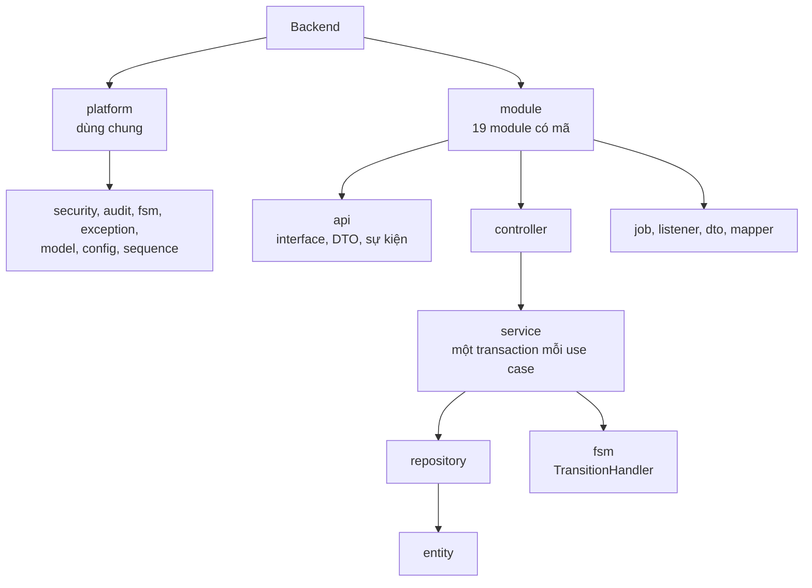
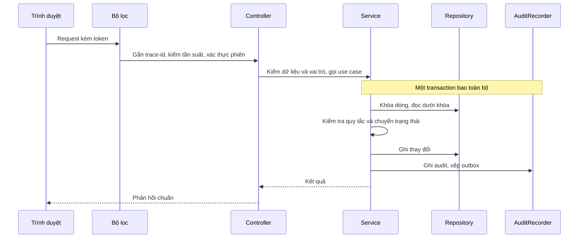
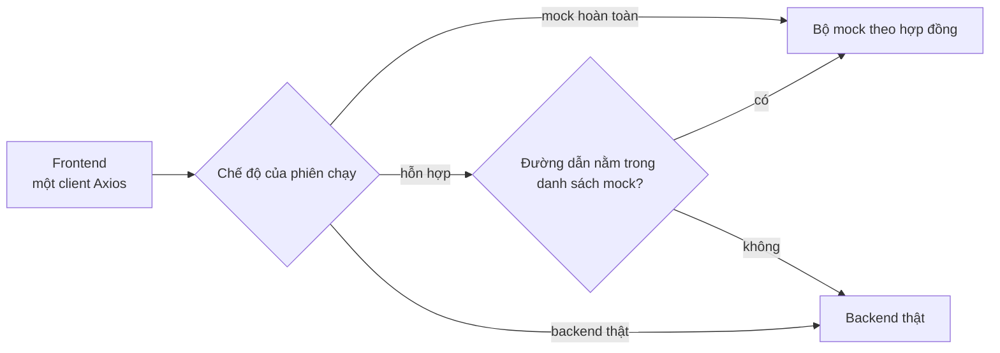

# Chương 4. Cài đặt

> Trạng thái: bản nháp (T86-5 phần đã có thật, 25/11/2026). Mã tầng 3 còn đổi tới khoảng 10/12/2026; chương hoàn thiện sau T83. Số liệu: [`00-so-lieu.md`](./00-so-lieu.md), đo 25/11/2026 trên `037141c2`.

Chương này nói hệ thống được cài đặt ở thành phần nào; thiết kế và lý do ở chương 3. Chỉ nêu cơ chế có mã.

## 4.1. Yêu cầu hệ thống và môi trường

**Công cụ và thiết bị.** Backend dùng Java 21 và Maven; frontend dùng Node.js và npm; Docker Desktop là bắt buộc cho môi trường dựng sẵn và kiểm thử tích hợp. Giao diện được kiểm thử ở khung nhìn máy tính để bàn bằng trình duyệt hiện đại. `TODO(T84)`: cấu hình máy tối thiểu.

**Dựng môi trường.** Docker Compose khai báo năm dịch vụ: PostgreSQL (ảnh pgvector), Redis, Mailpit (SMTP giả), backend, frontend. Khi backend khởi động, Flyway áp các migration (V1 đến V64 và V66, V49 và V65 để trống) và nạp 87 khóa [CFG]. ADMIN đầu tiên tạo bằng SQL; dữ liệu mẫu dựng bằng tập lệnh gọi API của backend.

**Cổng và biến.** Backend 8081 khi chạy trực tiếp, 8080 trong Docker; frontend 5173 và 3000 (Docker); PostgreSQL 5432 (`DB_PORT`; đặt 5434 nếu máy đã có PostgreSQL riêng); Redis 6379; Mailpit SMTP 1025, giao diện 8025. Biến của backend: `DB_*`, `REDIS_*`, `MAIL_*`, `RATE_LIMIT_*`, `PAYMENT_*`, `JWT_SECRET` (bắt buộc), `GEMINI_API_KEY`, `GOOGLE_CLIENT_ID`; thiếu hai khóa cuối thì chatbot không khả dụng và đăng nhập Google trả 503. Biến của frontend: `VITE_API_URL`, `VITE_API_MOCK`, `VITE_API_MOCK_ONLY`.

**Ba chế độ chạy.** *Phát triển:* Docker chạy PostgreSQL, Redis, Mailpit; backend chạy bằng Maven, frontend bằng Vite; backend ngoài Docker cần PostgreSQL có pgvector (bản thường làm Flyway lỗi từ V34) và một máy chủ SMTP. *Docker:* Compose dựng cả năm dịch vụ. *Kiểm thử:* Testcontainers dựng PostgreSQL pgvector thật.

## 4.2. Công nghệ sử dụng

**Bảng 4.1. Công nghệ theo lớp (đọc ngày 25/11/2026)**

| Lớp | Thành phần và phiên bản |
|---|---|
| Backend | Java 21; Spring Boot 3.5.15; Flyway 11.7.2; jjwt 0.12.3; MapStruct 1.6.3; springdoc-openapi 2.8.11; jsoup 1.18.3; Apache POI 5.2.5 và PDFBox 2.0.27 (đọc `.docx`, `.pdf` khi nạp tri thức AI) |
| Frontend | React 18.3.1; React Router 6.30.6; Vite 5.4.21; TypeScript 5.9.3; Tailwind CSS 4.3.3; TanStack Query 5.101.4; Zustand 4.5.7; Axios 1.20.0; Zod 3.25.76; React Hook Form 7.88.0 |
| Hạ tầng | PostgreSQL 17 (ảnh pgvector); Redis 7; Mailpit; Node 20 (ảnh frontend) |
| AI | Gemini qua `RestClient` của Spring; embedding 768 chiều |
| Kiểm thử | Testcontainers 1.21.4; Vitest 3.2.7; Playwright 1.63.0 |

*Nguồn: Bảng S.4. Ảnh PostgreSQL, Redis, Mailpit không ghim bản nhỏ.*

Lý do chọn: Bảng 1.3 dòng 9, 11, 13.

## 4.3. Cấu trúc mã nguồn

Kho mã gồm backend, frontend, thư mục tài liệu, các tập lệnh (kho tri thức AI, bộ đo chatbot, dữ liệu demo; tập lệnh seed của frontend bị Git bỏ qua) và cấu hình tích hợp liên tục.

**Hình 4.1. Cấu trúc module backend.** *Nguồn: `CLAUDE.md` (Backend architecture); `docs/convention/backend/01-package-structure.md`; Bảng S.4.*

Gói `platform` không phụ thuộc module nào; module chỉ dùng gói `api` của module khác. Trong module, controller không chứa logic và service giữ transaction. Frontend gồm lớp ứng dụng (định tuyến), trang theo miền chức năng, thành phần giao diện theo nhóm người dùng và lớp dùng chung (bộ gọi API, store Zustand, hook, bộ mock); thành phần bảo vệ tuyến chặn trang theo bảy vai trò.

## 4.4. Các cơ chế cài đặt đáng kể

**Lớp cơ sở máy trạng thái.** `StateMachineBase` nhận từ lớp con bảng chuyển hợp lệ; chuyển ngoài bảng ném lỗi, chuẩn hóa thành 409. 16 lớp `TransitionHandler` kế thừa nó, chép bảng chuyển từ đặc tả. Số 16 nhỏ hơn 23 máy trạng thái của đặc tả (Bảng S.1); chưa đối chiếu máy nào chưa có lớp riêng. `TODO(T84)`: đối chiếu từng máy.

**Ghi audit.** `AuditRecorder` là điểm duy nhất ghi audit, bắt buộc nằm trong transaction của use case nên rollback nghiệp vụ thì audit mất theo; sự kiện thất bại cần giữ vết có thao tác ghi độc lập sau rollback (Bảng 1.3 dòng 12).

**Sổ kho và FEFO.** `StockLedger` là nơi duy nhất đổi số lượng lô, mỗi lần ghi một dòng biến động kho cùng transaction và chỉ nhận lô đã khóa dòng. `FefoAllocator` chia số lượng xuất theo hạn dùng tăng dần, không xuất lô hết hạn.

**Sinh mã chứng từ.** `DocumentCodeGenerator` sinh mã liên tục theo loại và tháng bằng `INSERT … ON CONFLICT DO UPDATE` trên bảng bộ đếm; khóa dòng giữ đến hết transaction nên rollback thì số quay lại.

**Thứ tự khóa.** Mỗi use case ghi nằm trong một transaction: phân quyền, khóa, đọc dưới khóa, kiểm tra, ghi. Khóa dòng dùng `FOR NO KEY UPDATE` theo thứ tự cố định mỗi vùng nghiệp vụ; khóa tư vấn (advisory lock) của PostgreSQL dùng cho bốn vùng (thú và đặt lịch, khách, feedback, liều vaccine). Deadlock trả 409; job bỏ qua dòng bị khóa (`SKIP LOCKED`).

**Giới hạn tần suất.** `RateLimitFilter` đứng trước bộ lọc xác thực nên request bị chặn không tới BCrypt hay cơ sở dữ liệu. Nó đếm `POST` theo IP bằng `RedisRateLimiter` (cửa sổ cố định 60 giây): đăng nhập 30, đăng ký 10, mật khẩu 10; chat AI 10 mỗi phút rồi 60 mỗi giờ. Vượt ngưỡng trả 429; Redis lỗi thì cho qua (Bảng 1.3 dòng 11).

**Hàng đợi outbox.** Nghiệp vụ xếp thông báo vào bảng outbox cùng transaction với thao tác gốc; ba luồng gửi (thư ưu tiên, thư thường, trong ứng dụng) mỗi luồng một job. Gửi lỗi thì thử lại sau 1, 2, 4, 8 phút; lần thứ năm thất bại thì thành `FAILED`.

**Lập lịch job.** 26 lớp `*Job` với 28 annotation `@Scheduled`, múi giờ Asia/Ho_Chi_Minh, bộ lập lịch 4 luồng; lớp job không mở transaction. Thời gian lấy từ bean `Clock` nên test điều khiển được.

**Sự kiện đồng bộ.** Bảy bản ghi sự kiện nằm ở gói `api`; listener chạy cùng transaction với bên phát, ngoại lệ duy nhất là nạp chỉ mục tri thức AI (sau commit). Interface chưa có bản thật được đặt lớp placeholder ném `UnsupportedOperationException`.

**Client Gemini và pgvector.** `GeminiClient` gọi Gemini qua `RestClient`, cài cả interface mô hình ngôn ngữ và embedding, không thử lại trong cùng request. Tài liệu cắt đoạn 300–1200 ký tự, embedding 768 chiều, truy hồi bằng khoảng cách cosine của pgvector, lấy tối đa 5 đoạn có độ tương đồng từ 0,60 (chương 6).

**Cổng thanh toán.** Module thanh toán dùng interface trung lập, bản giả lập (mặc định) hoặc VNPay môi trường thử, chọn bằng `PAYMENT_GATEWAY`; thanh toán của khách chưa có handler (Bảng 4.3).

**Trình sinh hợp đồng OpenAPI.** Hợp đồng HTTP (347 thao tác trong 24 tệp) sinh từ tập lệnh Python và kiểm bằng tập lệnh Node; một test tích hợp đối chiếu tài liệu Swagger với hợp đồng. Ngày 25/11/2026, 297 trên 297 handler khớp hợp đồng. Hình 4.2 ghép các cơ chế trên thành chuỗi gọi của một use case ghi.

**Hình 4.2. Chuỗi gọi của một use case ghi.** *Nguồn: `CLAUDE.md` (Request flow; Transactions, locking, concurrency); ADR-0001, ADR-0012.*

## 4.5. Frontend: từ dữ liệu mô phỏng đến backend thật

Frontend được dựng song song với backend trên một bộ mock trả dữ liệu đúng hợp đồng HTTP, rồi nối backend thật theo module; phiên chạy có ba chế độ (Hình 4.3). Chế độ hỗn hợp chỉ giúp xem từng màn riêng lẻ vì mock có dữ liệu riêng.

**Hình 4.3. Ba chế độ dữ liệu của frontend.** *Nguồn: `docs/architecture/frontend-notes.md`; `docs/be-fe-integration.md`.*

Mỗi cụm chức năng nối theo sáu bước: dựng backend thật trên cơ sở dữ liệu tạm; chạy các ca; phân loại sai lệch; sửa frontend kèm test (chỉnh mock nếu mock che lỗi, chỉ ghi chú lỗi backend); chạy kiểm kiểu, lint, Vitest; cập nhật bảng theo dõi. Mock không được dễ dãi hơn backend: thứ tự kiểm lỗi đo trên backend thật rồi chỉnh mock theo.

**Bảng 4.2. Các lần nối với backend thật (theo tài liệu nhóm, chưa đo lại)**

| Ngày | Nội dung nối |
|---|---|
| 27/10–5/11 | Giai đoạn 1 theo cụm, trên cơ sở dữ liệu tạm, phần lớn tự động |
| 11/11, 16/11 | AI; phí vận chuyển; feedback |
| 17–18/11 | Cửa hàng online (khách, lễ tân); kiểm lại trên dữ liệu demo 25/11 |
| 23/11, 25/11 | Nhân sự; nội trú (chỉ trên bản sao) |

*Nguồn: `docs/be-fe-integration.md` mục 3, 8; Bảng S.2.*

Lỗi phát hiện khi nối (theo tài liệu nhóm, chưa đo lại) thuộc tám nhóm: đăng nhập không trả mã chi nhánh; cấu hình thử lại khiến lỗi 4xx bị thử nhiều lần; mock dễ dãi hơn backend; giao diện mở lối vào cho vai trò bị 403; thứ tự kiểm lỗi của mock khác backend; CORS chỉ cho hai origin; IDE biên dịch đè lớp đã dựng gây lỗi 500; thao tác phụ thuộc giờ mở cửa.

## 4.6. Kết quả cài đặt

Bảng 4.3 rút gọn Bảng S.2 (BE: thao tác của hợp đồng đã có handler, chưa đo hành vi; FE: theo tài liệu nhóm): **tình trạng ngày 25/11/2026, sẽ cập nhật ở T84**.

**Bảng 4.3. Trạng thái cài đặt theo module**

| Module | BE (đã có / hợp đồng) | FE |
|---|---|---|
| identity, appointment, visit, branch, customer, inventory, sales, boarding, content, report | Đủ | Chạy thật; kiểm tay đăng nhập Google chưa có kết quả |
| catalog; care | 22 / 22; 8 / 10 | Mở trang thật; chạy thật |
| ai; workforce; inpatient | 14 / 14; 17 / 17; 10 / 10 | Nối thật; nhân sự, nội trú chỉ trên bản sao |
| shop; fees | 18 / 19; 2 / 4 | Nối phần đã có, còn lại mock |
| payment; returns | 3 / 6; 3 / 9 | Mock |
| materialuse, stockops, branchlife, custmerge, articlex | 0 / 3, 0 / 13, 0 / 4, 0 / 2, 0 / 14 | Mock |
| **Tổng** | **230 / 232**; **67 / 115** | |

*Nguồn: Bảng S.2. Tác vụ hệ thống: giai đoạn 1 đủ 12 / 12; giai đoạn 2 có 8 / 10, chưa có ST07 và ST11.*

Chưa có ảnh giao diện (chỉ chụp từ bản chạy thật). Cần chụp ở T84:

1. Khách vãng lai: trang công khai, đăng ký, đăng nhập. TODO(T84)
2. Khách hàng: đặt lịch theo khung giờ trống. TODO(T84)
3. Khách hàng: hồ sơ thú cưng, tab sức khỏe. TODO(T84)
4. Khách hàng: cửa hàng online, đặt hàng. TODO(T84)
5. Khách hàng: lưu trú, nhật ký chăm sóc. TODO(T84)
6. Khách hàng: chatbot và gợi ý. TODO(T84)
7. Lễ tân: tiếp nhận, hàng đợi, gán người. TODO(T84)
8. Lễ tân: thu tiền gộp Order, ca thu ngân. TODO(T84)
9. Lễ tân: xử lý đơn online. TODO(T84)
10. Lễ tân: nhận thú, nhật ký, trả thú. TODO(T84)
11. Bác sĩ thú y: khám, kê đơn, tiêm chủng. TODO(T84)
12. Bác sĩ thú y: nội trú, y lệnh. TODO(T84)
13. Nhân viên chăm sóc: dịch vụ thẩm mỹ. TODO(T84)
14. Quản lý chi nhánh: giờ mở cửa, phân ca. TODO(T84)
15. Quản lý chuỗi: báo cáo, danh mục, phí vận chuyển. TODO(T84)
16. Quản trị hệ thống: cấu hình, mẫu thông báo, audit. TODO(T84)

## 4.7. Hạn chế và nợ kỹ thuật

- **Tích hợp liên tục.** Với pull request, quy trình chỉ kiểm dấu xung đột, biên dịch, unit test backend, kiểm kiểu và build frontend; Vitest và Playwright không chạy, lint không chặn; test tích hợp chỉ chạy khi đẩy lên nhánh chính hoặc chạy tay; bước triển khai mới là chỗ giữ chỗ.
- **Chưa có handler:** các thao tác ở Bảng 4.3, ST07 và ST11; hai lớp placeholder (ca thu ngân, đơn online) vẫn là component.
- **Chưa kiểm với backend thật:** đăng nhập Google, làm mới token lâu dài (Bảng 1.3 dòng 10), nhân sự và nội trú trên dữ liệu demo.
- **Hạ tầng và quy trình:** ảnh không ghim bản nhỏ; Redis chạy không mật khẩu khi phát triển (ADR-0100); sáu số ADR trùng; sổ nợ của nhóm không nằm trong Git.

## 4.8. Kết luận chương

Hệ thống gồm hai ứng dụng độc lập: backend modular monolith viết bằng Java và Spring Boot, frontend ứng dụng một trang viết bằng React và TypeScript, cùng dùng PostgreSQL có pgvector, Redis và một máy chủ SMTP, đóng gói bằng Docker Compose. Các module backend chỉ giao tiếp qua gói công bố của nhau.

Các bảo đảm của nghiệp vụ nằm ở những thành phần chỉ ra được: lớp cơ sở máy trạng thái, bộ ghi audit trong transaction, sổ kho tập trung kèm FEFO, bộ sinh mã chứng từ liên tục, thứ tự khóa cố định, hàng đợi outbox có thử lại, bộ lọc giới hạn tần suất, client Gemini cùng chỉ mục pgvector. Frontend được dựng trên dữ liệu mô phỏng khớp hợp đồng rồi nối thật theo cụm; quá trình nối phát hiện nhiều lỗi về dữ liệu, thứ tự kiểm lỗi, phân quyền giao diện và môi trường.

Giai đoạn 1 gần như đủ handler, giai đoạn 2 mới có một phần; module chưa có backend chạy trên mock (Bảng 4.3). Chương 5 trình bày kiểm chứng, chương 6 trình bày phân hệ AI.

## Nguồn

`DeCuongDoAn.md` (mục 2.3); `docs/architecture/{concurrency-locking,frontend-notes}.md`; `docs/be-fe-integration.md`; `docs/convention/backend/01-package-structure.md`; `docs/api/{check-contracts.mjs,generator/}`; `CLAUDE.md`; `BE/pom.xml`; `FE/package.json`, `FE/package-lock.json`; `docker-compose.yml`; `.env.example`; `.github/workflows/ci.yml`; `BE/src/main/java/com/petcare/{platform,module}`; [`00-so-lieu.md`](./00-so-lieu.md) (Bảng S.1, S.2, S.4).

ADR: 0001, 0012, 0100. ADR trùng số, trích kèm tên tệp: `0123-fe-refresh-token-user-action`; `0148-workforce-contract-error-order-staff-reads`; `0149-workforce-foundation-entities-fsm`; `0149-inpatient-foundation-entities-fsm`.

## TODO

- `TODO(T84)`: cấu hình máy tối thiểu (4.1); đối chiếu từng máy trạng thái (4.4); làm mới Bảng 4.3 theo Bảng S.2; chụp 16 màn hình ở 4.6; kiểm lại tầng 3 sau T83.
- Chờ mẫu của khoa để chốt tên các mục.
- Danh mục hình chưa có Hình 4.3; chạy lại trình phân tích Mermaid 11 cho Hình 4.1 đến 4.3.
