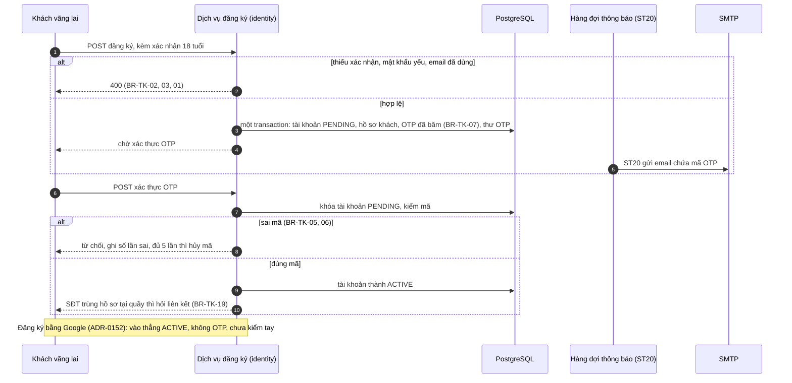
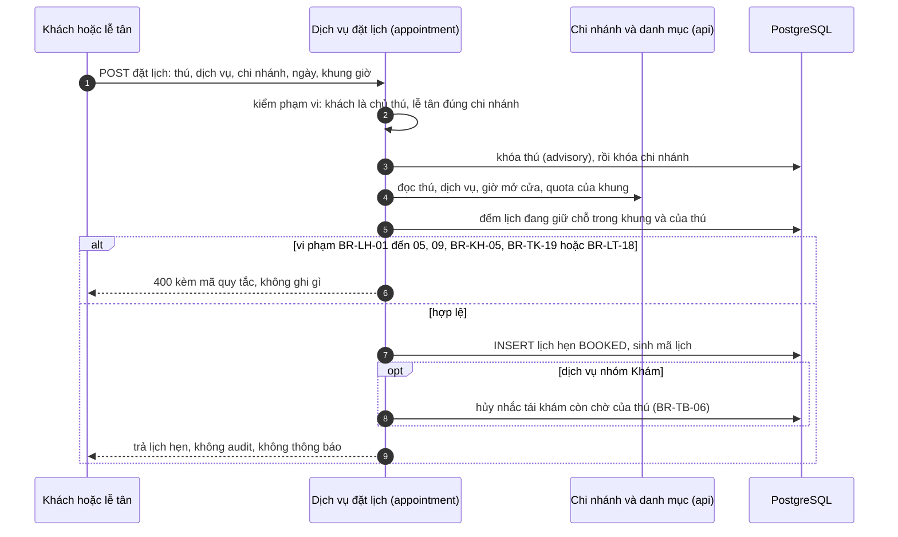
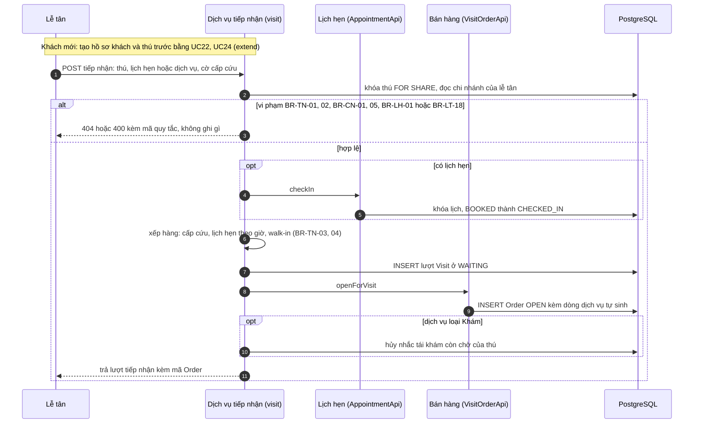
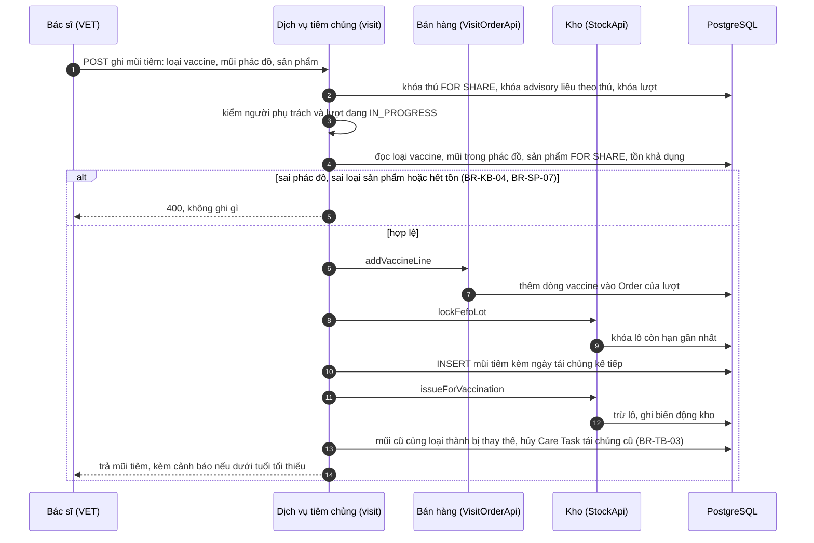
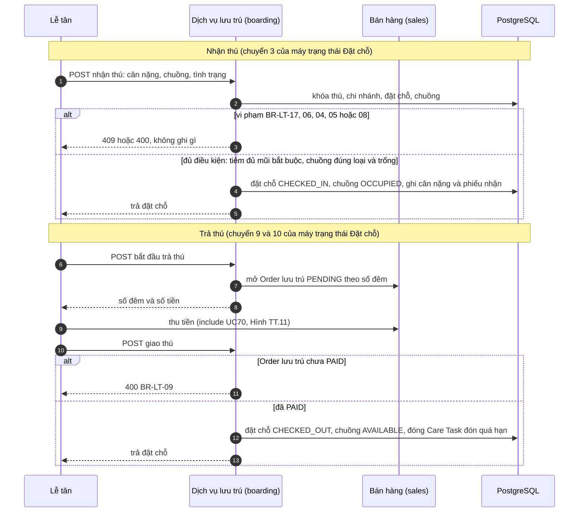
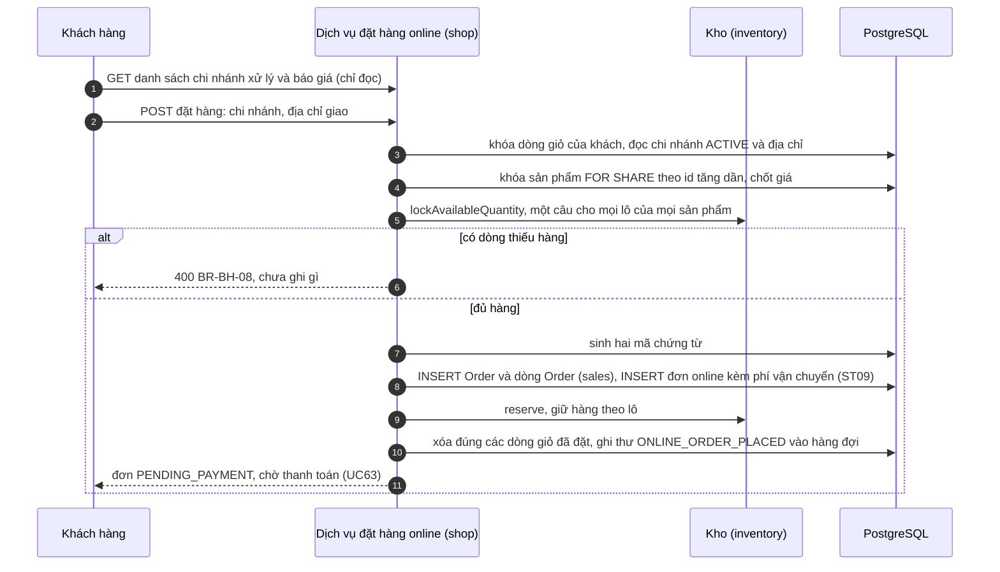
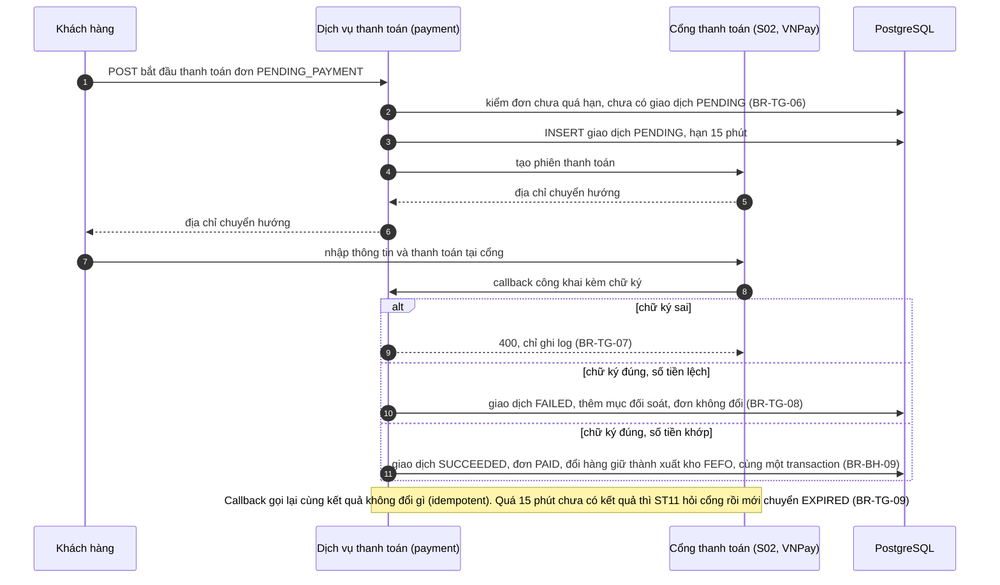
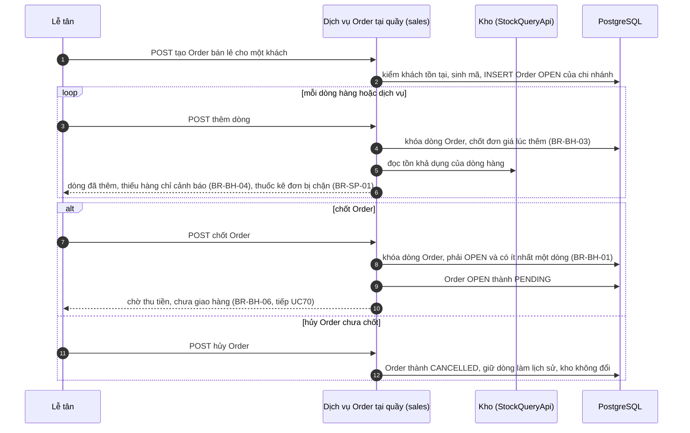
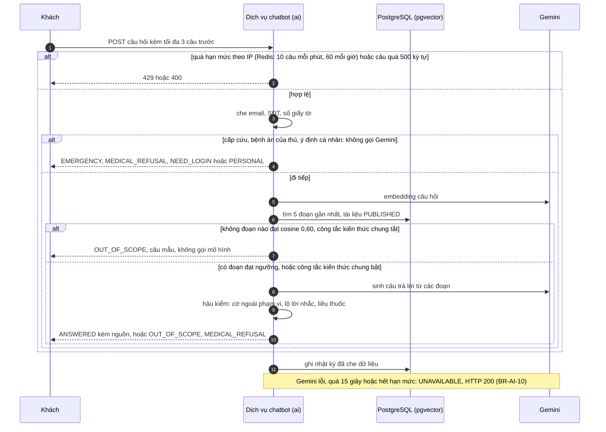
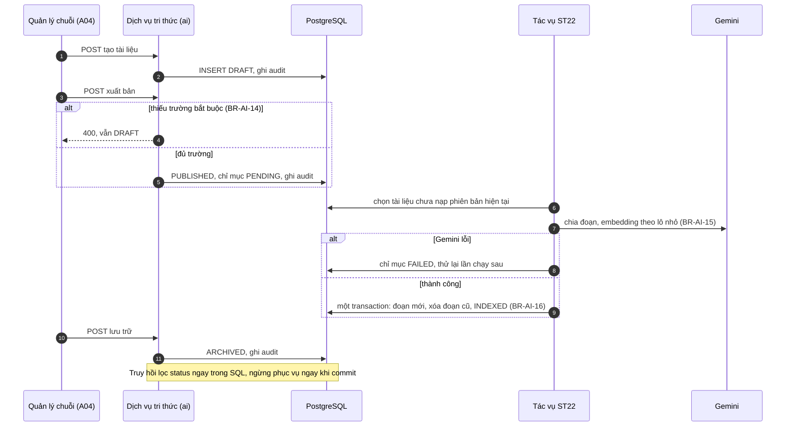

# Biểu đồ tuần tự (kho nội dung cho mục 3.3.3 của `BAO CAO.docx`)

> Trạng thái: bản nháp 26/11/2026. Mười hình mới (TT.1, TT.3, TT.4, TT.6 đến TT.10, TT.12, TT.13) cùng ba hình đã có ở [`03-thiet-ke.md`](./03-thiet-ke.md) (TT.2, TT.5, TT.11). **Số hình `TT.n` là số tạm**: đánh lại theo chương khi xuất docx. Cú pháp và hình render ghi ở mục cuối.
>
> Cách vẽ: cùng mức trừu tượng với Hình 3.5 (người dùng, dịch vụ của module, module khác qua `api`, PostgreSQL; thêm bên ngoài chỉ khi use case có: SMTP, Redis, Gemini, cổng thanh toán). Mỗi nhánh `alt` gắn mã quy tắc nghiệp vụ. Thứ tự thao tác lấy từ phần mô tả đầu lớp dịch vụ trong mã nguồn ngày 26/11/2026; **chưa chạy thử từng luồng để quan sát**, nên đây là sơ đồ thiết kế đối chiếu với mã, không phải kết quả đo.

**Bảng. Ba hình đã có, dùng lại**

| Hình tạm | Use case | Hình hiện có | Vị trí |
|---|---|---|---|
| TT.2 | UC03 Đăng nhập | Hình 3.5 | `03-thiet-ke.md` mục 3.6 |
| TT.5 | UC48 Khám bệnh (hoàn tất lượt, khóa bệnh án) | Hình 3.6 | `03-thiet-ke.md` mục 3.7 |
| TT.11 | UC70 Thu tiền tại quầy | Hình 3.7 | `03-thiet-ke.md` mục 3.7 |

## TT.1. Đăng ký tài khoản (UC01, gồm UC02)

**Hình TT.1. Chuỗi đăng ký và xác thực OTP.** *Nguồn: `RegistrationService.registerAccount`, `verifyAccount`; BR-TK-01 đến BR-TK-08; ADR-0009, ADR-0010, ADR-0011, ADR-0152. Việc gửi thư do ST20 làm sau, ngoài transaction đăng ký (mục 3.8).*

## TT.2. Đăng nhập và làm mới token (UC03): dùng lại Hình 3.5

Mã Mermaid nằm ở [`03-thiet-ke.md`](./03-thiet-ke.md) mục 3.6, không chép lại ở đây để khỏi lệch.

**Hình TT.2. Chuỗi đăng nhập và làm mới token xoay vòng (UC03).** *Nguồn: Hình 3.5 của `03-thiet-ke.md`; ADR-0003, ADR-0091; `docs/api/00-method.md` mục 3.1.*

## TT.3. Đặt lịch hẹn (UC39)

**Hình TT.3. Chuỗi đặt lịch hẹn (Lịch hẹn#1).** *Nguồn: `AppointmentBookingService.bookAppointment`; BR-LH-01 đến BR-LH-05, BR-LH-09, BR-KH-05, BR-TK-19, BR-LT-18; ADR-0045, ADR-0047. Quota (BR-LH-03) đọc sau khi đã khóa thú và chi nhánh, nên hai người đặt cùng khung không vượt chỗ.*

## TT.4. Tiếp nhận khách (UC44)

**Hình TT.4. Chuỗi tiếp nhận khách (Visit#1).** *Nguồn: `VisitCheckInService.checkInVisit`; BR-TN-01 đến BR-TN-04, BR-CN-01, BR-CN-05; ADR-0058, ADR-0088; `docs/01` mục C (UC44 extend UC22). Mọi hệ quả liên module nằm trong một transaction.*

## TT.5. Hoàn tất lượt khám và khóa bệnh án (UC48): dùng lại Hình 3.6

Mã Mermaid nằm ở [`03-thiet-ke.md`](./03-thiet-ke.md) mục 3.7. Khi vẽ PNG, tên ba cột `AdmissionQueryApi`, `AppointmentApi`, `VisitOrderApi` được rút còn "(api)" để nhãn không bị cắt giữa từ.

**Hình TT.5. Chuỗi hoàn tất lượt khám và khóa bệnh án (UC48, Visit#5).** *Nguồn: Hình 3.6 của `03-thiet-ke.md`; `docs/06-module-contracts.md` mục 4.1; ADR-0069; ADR-0149 mục 21.*

## TT.6. Tiêm chủng (UC49)

**Hình TT.6. Chuỗi ghi nhận mũi tiêm.** *Nguồn: `VaccinationRecordService.record`; BR-KB-04, BR-KO-05, BR-TB-03; ADR-0074. Vaccine được trừ kho ngay lúc ghi mũi, không đợi thu tiền (BR-BH-04). Khóa advisory 1004 theo thú giữ cho hai bác sĩ không ghi trùng liều.*

## TT.7. Nhận và trả thú lưu trú (UC59)

**Hình TT.7. Chuỗi nhận và trả thú lưu trú.** *Nguồn: `BoardingCheckInService.checkIn`, `BoardingCheckoutService.startCheckout`, `handOver`; BR-LT-04 đến BR-LT-09, BR-LT-17; ADR-0085, ADR-0086, ADR-0149. Thu tiền trước, giao thú sau, không ngoại lệ (BR-LT-09).*

## TT.8. Đặt hàng online (UC62)

**Hình TT.8. Chuỗi đặt hàng online từ giỏ.** *Nguồn: `OnlineOrderService.place`; BR-BH-08, BR-BH-09, BR-SP-08; ADR-0144. Đã cài đặt và nối giao diện với backend thật (hợp đồng `shop` #1 đến #18, tình trạng 25/11/2026). Không audit (khách tự phục vụ).*

## TT.9. Thanh toán online (UC63): đặc tả, chưa cài đặt

**Hình TT.9. Chuỗi thanh toán online qua cổng (UC63): đặc tả, chưa cài đặt.** *Nguồn: `docs/08` mục C (Giao dịch#1, #2, #3; BR-TG-06 đến BR-TG-11, máy trạng thái #15); `docs/payment-gateway-setup.md`. **Đặc tả, chưa cài đặt tại ngày 25/11/2026**: ba thao tác bắt đầu thanh toán, tra trạng thái giao dịch và callback chưa có handler, ST11 chưa có (Bảng S.2). Phần đối soát (ST14) đã có mã nhưng không nằm trong hình.*

## TT.10. Bán hàng và chốt Order tại quầy (UC66)

**Hình TT.10. Chuỗi bán lẻ tại quầy (Order#2, #5, #7).** *Nguồn: `RetailOrderService`, `OrderLineService`; BR-BH-01, BR-BH-03, BR-BH-04, BR-BH-06, BR-SP-01; ADR-0044, ADR-0051. Kho chỉ cảnh báo khi thêm dòng; trừ kho xảy ra lúc thu tiền (Hình TT.11).*

## TT.11. Thu tiền tại quầy (UC70): dùng lại Hình 3.7

Mã Mermaid nằm ở [`03-thiet-ke.md`](./03-thiet-ke.md) mục 3.7.

**Hình TT.11. Chuỗi thu tiền Order tại quầy (UC70, Order#8).** *Nguồn: Hình 3.7 của `03-thiet-ke.md`; `docs/06-module-contracts.md` mục 5; `docs/architecture/concurrency-locking.md`; ADR-0064.*

## TT.12. Hỏi đáp chatbot (UC90)

**Hình TT.12. Chuỗi hỏi đáp của chatbot.** *Nguồn: `docs/07` mục 5.2; BR-AI-03 đến BR-AI-10, BR-AI-12; ADR-0136, ADR-0141, ADR-0157; thứ tự lớp chặn đã nêu ở Hình 6.2 và Bảng 6.2 của `06-phan-he-ai.md`. Hình bỏ các công tắc nghiệp vụ, lời chào, ngữ cảnh thú và chế độ mở (mặc định tắt) và bước phân loại câu hỏi cá nhân mơ hồ của chat đăng nhập (công tắc `intent_llm_enabled`, mặc định bật, ADR-0157), nên "ý định cá nhân" trong hình là loại nhận ra bằng luật từ khóa; công tắc kiến thức chung bật hay tắt là trạng thái cấu hình, đọc lại ở ngày chốt (Bảng S.5).*

## TT.13. Quản lý tri thức chatbot (UC93)

**Hình TT.13. Vòng đời tài liệu tri thức: tạo, xuất bản, nạp chỉ mục, lưu trữ.** *Nguồn: `docs/07` mục 5.3, mục 9 (máy trạng thái #13, các chuyển #1, #2, #4); BR-AI-14 đến BR-AI-17; ADR-0130. Hình không vẽ các đường do ST22 tự chuyển trạng thái (chuyển #5, #7, #8).*

## Kiểm cú pháp và render

Đo ngày 26/11/2026 bằng Mermaid 11.17.2 chạy trong Chrome: **13/13 khối qua trình phân tích và dựng được SVG**. PNG ở [`hinh/TT.1.png` đến `hinh/TT.13.png`](./hinh/), tỷ lệ 2x. **Đã xem cả 13 hình PNG sau lần dựng cuối** (nhãn đọc được, không bị cắt; còn vài nhãn dài trùm lên đường sống của cột khác, vẫn đọc được).

Thiết lập dựng PNG, khác bản xem trực tiếp trên GitHub hoặc VS Code:

- Chủ đề `neutral` (đen trắng, hợp bản in), chữ Times New Roman 14 px, **không đánh số tự động** (số thứ tự đè lên nhãn dài).
- Chiều rộng mỗi hình chia theo số cột (khoảng 800 px) để khi vào trang Word rộng 15,5 cm, cỡ chữ ra khoảng **7,5 đến 7,7 pt** và hình cao không quá 21 cm. Cỡ chữ này nhỏ: cột nhiều hơn hoặc nhãn dài hơn thì chữ nhỏ thêm, nên giữ mỗi hình dưới sáu cột và dưới mười hai thông điệp.
- TT.5 (hình cũ có sáu cột): khi vẽ PNG, tên `AdmissionQueryApi`, `AppointmentApi`, `VisitOrderApi` rút còn "(api)".
- Mermaid coi `#` là mã thực thể: không dùng `#` trong nhãn (viết "chuyển 3", không viết "Đặt chỗ#3").

Tập lệnh dựng (ngoài kho): `D:/Do-an/.c2-tmp/t86/seq/render.mjs` (cần Chrome; Mermaid cài trong thư mục đó). Chạy lại sau khi sửa khối Mermaid rồi chép PNG vào `hinh/`. Hình trong `BAO CAO.docx` là bản chèn một lần (`insert_figs.py`), không tự cập nhật.

**Chưa làm:** chưa chạy thử từng luồng để quan sát (xem đầu tệp); các cờ cấu hình của chatbot (TT.12) và trạng thái cài đặt (TT.9) phải đọc lại ở ngày chốt.
